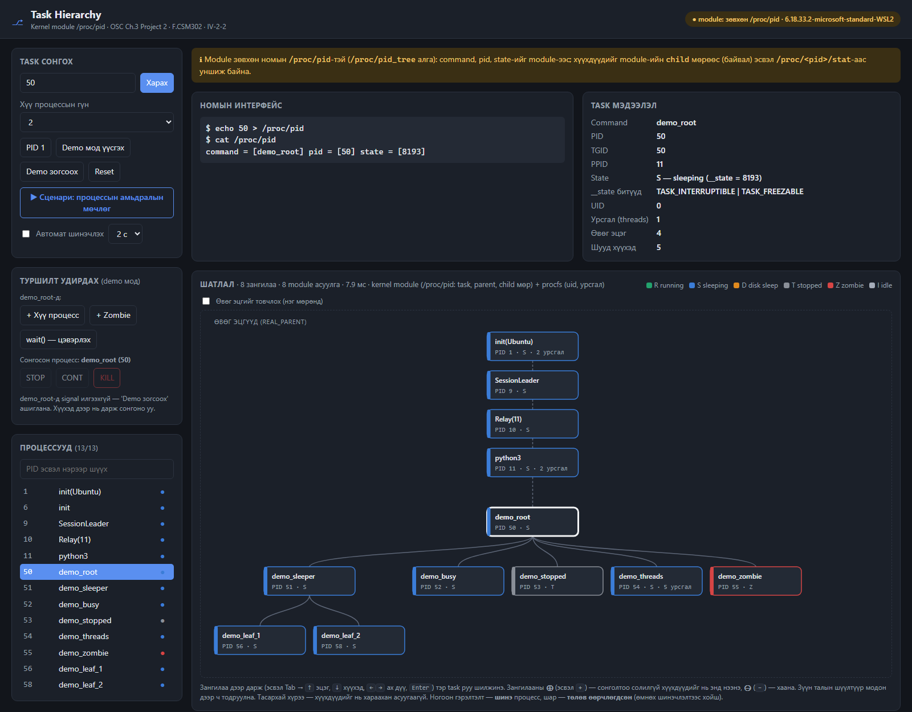
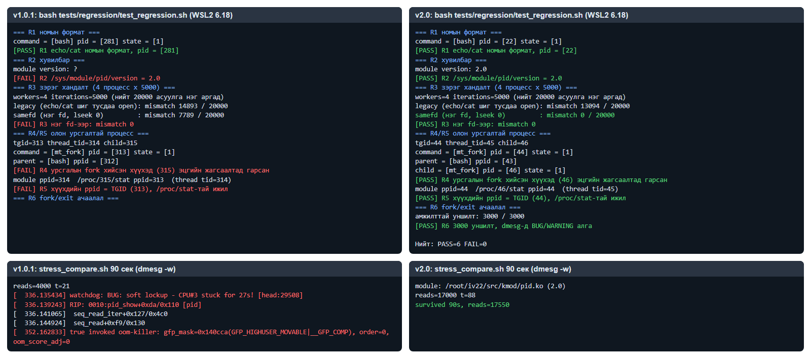

# IV-2-2 – Linux Kernel Module for Task Information

**Хичээл:** F.CSM302 Үйлдлийн систем • Бие даалт 2 (Final, `v2.0.0`)
**Хуваарилалтын код:** IV-2-2 · **Бидний шүүмжилсэн баг:** V-1-13 (Banker's Algorithm), IV-2-5 (Sudoku Validator) · **Бидэнд шүүмж бичих баг:** IV-2-5 (ирүүлээгүй, тиймээс self-review хийсэн)
**Сурах бичиг:** Operating System Concepts (2018), 3-р бүлэг, Programming Project 2
**UI дүрслэл:** Task hierarchy

## Зорилго

`/proc/pid` файлаар дамжуулан PID хүлээн авч, тухайн task-ийн мэдээллийг (command, pid, state) буцаадаг Linux kernel module бичих. Мөн сонгосон процессын parent болон child-уудыг шатлалтай мод хэлбэрээр харуулдаг interactive UI хийх.

```bash
echo "1395" > /proc/pid
cat /proc/pid
command = [bash] pid = [1395] state = [1]
parent = [sshd] ppid = [1300]
child = [vim] pid = [1400] state = [1]
```

Эхний мөр нь номын яг формат. `parent`, `child` мөрүүд нь task hierarchy-д зориулсан өргөтгөл.



*v2 UI: demo процессын мод (S, T, Z төлөв, 5 урсгалтай процесс). `__state = 8193` нь `TASK_INTERRUPTIBLE | TASK_FREEZABLE` гэж тайлагдсан, өвөг эцгийн гинж module-ээс.*

## БД2-ын гол сайжруулалт (`v2.0.0`)

Шүүмжлэх баг Review ирүүлээгүй тул self-review хийсэн ([review/IV-2-2_Self_Review.md](review/IV-2-2_Self_Review.md)). Дэлгэрэнгүйг [Final Report](report/IV-2-2_Final_Report.pdf)-ийн §4-5-аас харна уу.

| Шүүмж | v1.0.1 | v2.0.0 |
|---|---|---|
| S1 `children` жагсаалтыг зөвхөн RCU-ийн дор гүйдэг | fork/exit ачаалалд `pid_show` дотор гацна: WSL2-д 21 сек-д soft lockup, bare-metal-д RCU stall, OOM, машин унасан | RCU-ээр хамгаалагдсан `for_each_process`; 90 сек алдаагүй (WSL2 17 550, bare-metal 38 673 уншилт) |
| S2 олон урсгалтай процесс | урсгалын fork хийсэн хүүхэд алга, ppid = TID | хүүхэд гарна, ppid = TGID (`ps`-тэй ижил) |
| S3 глобал PID | зэрэг ажиллахад нэг fd-ээр ч 7 789 / 20 000 зөрүү | нээлт бүр өөрийн PID-тэй: 0 / 20 000 |
| S4-S6 UI | PID 0 зөвшөөрнө; `__state` тайлдаггүй; өвөг эцэг procfs-оос | засагдсан |



## Quick Start

Ubuntu 24.04 / Debian (bare-metal эсвэл VM, kernel ≥ 5.14) дээр:

```bash
# 1. Хэрэгцээт сан
sudo apt install build-essential linux-headers-$(uname -r) python3

# 2. Kernel module-ийг хөрвүүлж ачаалах
cd src/kmod && make && cd ../..      # Makefile нь $(PWD)-г ашигладаг тул хавтсандаа орж make хийнэ
sudo insmod src/kmod/pid.ko
ls -l /proc/pid                      # -rw-rw-rw- ... /proc/pid

# 3. Номын жишээ
echo $$ > /proc/pid && cat /proc/pid # одоогийн bash
echo 1  > /proc/pid && cat /proc/pid # systemd / init

# 4. Task hierarchy UI
python3 src/ui/server.py             # → http://localhost:8000

# 5. Дуусгах
sudo rmmod pid
(cd src/kmod && make clean)
```

UI нь зөвхөн Python 3 стандарт сан, браузер ашиглана. Нэмэлт суулгац хэрэггүй. Дэлгэрэнгүйг [src/ui/README.md](src/ui/README.md)-ээс харна уу.

> **WSL2:** Microsoft-ын кернелд `linux-headers` багц байдаггүй. Кернелийн эх кодыг ажиллаж буй хувилбартай тааруулж бэлдэнэ (`src/prereq/` — B210930842). WSL-д PID namespace өөр тул module `task_pid_vnr()` ашиглаж байж `ps`-тэй ижил PID хэвлэнэ.

## Орчин

| | Хувилбар |
|---|---|
| OS | Ubuntu 22.04 / 24.04 / 26.04 LTS, Debian; bare-metal эсвэл VM (туршсан: Ubuntu 24.04.5 bare-metal, kernel `7.0.0-34-generic` (БД1), `7.0.0-42-generic` (БД2); Kubuntu 26.04.1, kernel `7.0.0-38-generic`; БД2 хөгжүүлэлт: WSL2 Ubuntu 26.04, kernel `6.18.33.2`) |
| Kernel API | `proc_ops` (≥ 5.6), `task_struct->__state` (≥ 5.14), `seq_file` |
| Хөрвүүлэгч | gcc 13.3 (Ubuntu 24.04), gcc 15.2 (Kubuntu 26.04, WSL2), GNU make |
| UI | Python ≥ 3.8 (туршсан 3.12, 3.14), орчин үеийн браузер (Edge, Chrome, Firefox) |
| Тест | bash, gcc (regression-ийн C программ), Python `unittest`; Node ≥ 18 (UI-ийн модны тест, заавал биш) |

## Repository бүтэц

| Хавтас | Агуулга | Хариуцагч |
|---|---|---|
| `src/prereq/` | 2-р бүлгийн бэлтгэл kernel module (`/proc` entry үүсгэх), build орчин | B210930842 (гүйцэтгэсэн: B190910014) |
| `src/kmod/` | Үндсэн kernel module (`pid.c`, `Makefile`) | B242270047 |
| `src/ui/` | Task hierarchy дүрслэлтэй interactive UI | B190910014 |
| `tests/basic/` | Номын жишээ болон үндсэн тестүүд | B231910003 |
| `tests/boundary/` | Захын болон буруу оролтын тестүүд | B231910003 |
| `tests/regression/` | БД2: зэрэг хандалт, олон урсгал, fork/exit ачаалал, хугацааны хэмжилт; `tests/run_bd2.sh` | B242270047 |
| `docs/` | Manual ([Manual.md](docs/Manual.md), [IV-2-2_Manual.pdf](docs/IV-2-2_Manual.pdf)), Poster ([IV-2-2_Poster.pdf](docs/IV-2-2_Poster.pdf), `poster/poster.html`), зургууд, [TASKS.md](docs/TASKS.md) | B241940099, B210930842 |
| `report/` | Эцсийн тайлан [IV-2-2_Final_Report.pdf](report/IV-2-2_Final_Report.pdf), БД1 тайлан [IV-2-2_BD1_Report.pdf](report/IV-2-2_BD1_Report.pdf) (+ `.tex`, `build_pdfs.sh`) | B232270108 (гүйцэтгэсэн: B190910014, B242270047) |
| `review/` | Бидний бичсэн шүүмж (V-1-13, IV-2-5), БД2-ын self-review ([IV-2-2_Self_Review.md](review/IV-2-2_Self_Review.md)) | B241940099, B242270047 |

## Тест

```bash
bash tests/basic/test_basic.sh            # номын жишээ, PID 1, байхгүй PID, child, kernel thread
bash tests/boundary/test_boundary.sh      # abc, -5, хоосон, 0, маш том тоо, overflow, урт мөр
bash tests/regression/test_regression.sh  # БД2: зэрэг хандалт, олон урсгалтай процесс, fork/exit ачаалал
python3 -m unittest src/ui/tests/test_api.py
python3 src/ui/contract_check.py          # module ба UI-ийн интерфейс (OK / WARN / FAIL)
```

Бүгдийг нэг дор (v1.0.1 ба v2-ийн өмнө/дараах харьцуулалттай): `bash tests/run_bd2.sh baremetal`. Үр дүн `tests/bd2_<нэр>/`-д хадгалагдана.

Бодит үр дүн: БД2 `tests/bd2_baremetal/` (Ubuntu 24.04.5, kernel 7.0.0-42, v1 ба v2), `tests/bd2_wsl/` (WSL2 6.18), БД1 `tests/*/result_baremetal.txt` (Ubuntu 24.04), `tests/*/result_acer_kubuntu.txt` (Kubuntu 26.04), орчны мэдээлэл `tests/env_*.txt`. Нэгтгэсэн хүснэгтийг [Manual](docs/Manual.md)-ийн A7 болон [Final Report](report/IV-2-2_Final_Report.pdf)-ийн §5-аас харна уу.

## Хувилбар ба ажлын заавар

- Хувилбарыг [Semantic Versioning](https://semver.org/lang/mn/) (`vMAJOR.MINOR.PATCH`)-ээр дугаарлана. БД1-ийн илгээлт → `v1.0.0` (засвар: `v1.0.1`), БД2 → `v2.0.0`. Өөрчлөлтийг [CHANGELOG.md](CHANGELOG.md)-д бичнэ.
- Branch, commit, Pull Request, review, release хийх дүрэм: [CONTRIBUTING.md](CONTRIBUTING.md).

## Багийн гишүүд

B242270047 · B190910014 · B210930842 · B231910003 · B232270108 · B241940099. Ажлын хуваарилалтыг [docs/TASKS.md](docs/TASKS.md)-ээс харна уу.

## Бэлэн код, сан, AI ашиглалт

- Kernel module нь номын Programming Project 2-ын skeleton (`proc_ops`, `kmalloc`, `copy_from_user`, `kstrtol`, `pid_task`, `find_vpid`) дээр суурилсан.
- Код болон баримт бичгийг боловсруулахад AI туслах (Claude) ашигласан; хариуцсан гишүүд уншиж, ажиллуулж, туршиж шалгасан. Гадны программын сан ашиглаагүй.
