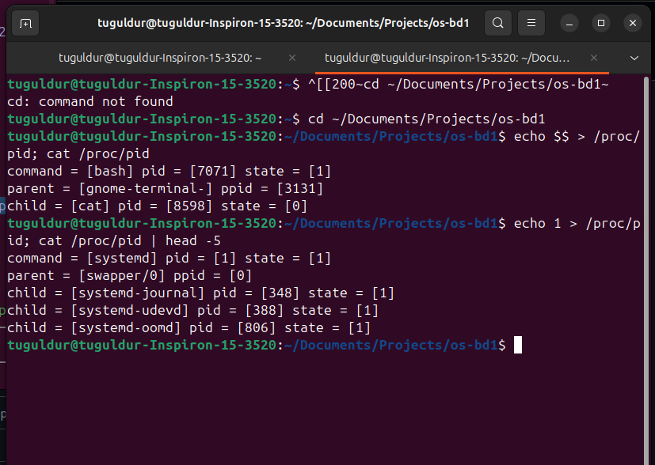
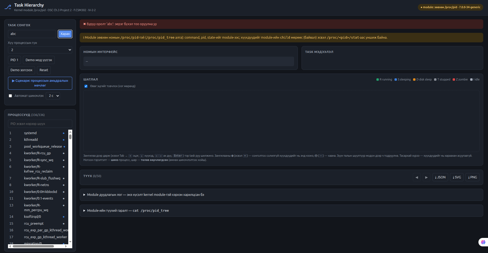

# IV-2-2 Task Hierarchy: Хэрэглэгчийн manual

**Хичээл:** F.CSM302 Үйлдлийн систем • Бие даалт 1 **Хуваарилалтын код:** IV-2-2
**Хэрэглэгчийн хэсгийг бичсэн:** B241940099 **Operational хэсэг:** B210930842 (§A)

> Энэ manual хоёр хэсэгтэй. **§A Operational** (суулгах, build, kernel-ийн хувилбар, dependency)-ийг B210930842 бичнэ. **§B Хэрэглэгчийн хэсэг** нь UI-г хэрхэн ашиглах, дэлгэц дээрх тэмдэг ба өнгө юу гэсэн үг, жишээ, түгээмэл алдааг тайлбарлана.

---

## §A. Operational хэсэг (B210930842)

Өөр компьютер дээр repository-г татаж, build хийж, ажиллуулж, тестлэх заавар (OS_BD1_Guide §8.2). Бэлтгэсэн: B190910014 (хариуцагч B210930842 хянаж баталгаажуулна).

### A1. Дэмжих орчин

| | Шаардлага | Туршсан |
|---|---|---|
| OS | Ubuntu 22.04 / 24.04 LTS, Debian 12; bare-metal эсвэл VM (VirtualBox, VMware). WSL2-д `linux-headers` багц байхгүй (A8) | Ubuntu 24.04.5 LTS bare-metal (`systemd-detect-virt` = `none`); Kubuntu 26.04.1 LTS (Acer Nitro, Secure Boot асаалттай) |
| Kernel | ≥ 5.14 (`struct proc_ops` ≥ 5.6, `task_struct->__state` ≥ 5.14) | `7.0.0-34-generic`; `7.0.0-38-generic` (Kubuntu); хөгжүүлэлтэд `6.6.87.2-microsoft-standard-WSL2` |
| Compiler | gcc + GNU make (`build-essential`); kernel-ийг хөрвүүлсэн gcc-тэй ижил хувилбар | gcc 13.3.0 (Ubuntu), gcc 15.2.0 (Kubuntu), gcc 11.4 (WSL2) |
| Kernel headers | `linux-headers-$(uname -r)` | |
| UI | Python ≥ 3.8 (стандарт сан), орчин үеийн браузер | Python 3.12 / 3.10, Edge, Chrome, Firefox |
| Тест | bash; Node ≥ 18 (UI-ийн модны тест, заавал биш) | |
| Эрх | `insmod`, `rmmod` командад `sudo` хэрэгтэй | |

### A2. Repository татах

```bash
git clone https://github.com/Tugu8/os-bd1-IV-2-2-.git
cd os-bd1-IV-2-2-
git checkout v1.0.1          # БД1-ийн хамгийн сүүлийн хувилбар
```

### A3. Dependency суулгах

```bash
sudo bash src/prereq/setup_ubuntu_headers.sh
# эсвэл гараар:
sudo apt update
sudo apt install build-essential linux-headers-$(uname -r) python3
ls -d /lib/modules/$(uname -r)/build        # байх ёстой
```

**Secure Boot** асаалттай бол гарын үсэггүй module-ийг kernel татгалзана (`Key was rejected by service`). Хоёр арга бий: BIOS/UEFI-ээс Secure Boot-ийг унтраах, эсвэл өөрийн түлхүүрийг (MOK) бүртгээд module-д гарын үсэг зурах (Kubuntu 26.04 дээр ингэж туршсан):

```bash
openssl req -new -x509 -newkey rsa:2048 -nodes -days 36500 \
  -subj "/CN=IV-2-2 module/" -keyout MOK.priv -outform DER -out MOK.der
sudo mokutil --import MOK.der       # нууц үг тохируулна; дахин асаахад MOK Manager дээр Enroll MOK
# module-ийг build хийсний дараа (A4), insmod-оос өмнө:
sudo /lib/modules/$(uname -r)/build/scripts/sign-file sha256 MOK.priv MOK.der src/kmod/pid.ko
```

### A4. Build ба Run

```bash
# 1) 2-р бүлгийн бэлтгэл module-ууд (заавал биш, орчин зөв эсэхийг шалгана)
make -C src/prereq && sudo make -C src/prereq test          # 9 PASS

# 2) Үндсэн module
cd src/kmod && make && cd ../..            # Makefile нь $(PWD) ашигладаг тул хавтсандаа орж make
sudo insmod src/kmod/pid.ko
ls -l /proc/pid                            # -rw-rw-rw- 1 root root 0 ... /proc/pid
sudo dmesg | tail -1                       # /proc/pid created

# 3) Номын жишээ
echo $$ > /proc/pid && cat /proc/pid
echo 1  > /proc/pid && cat /proc/pid

# 4) UI
python3 src/ui/server.py                   # http://localhost:8000 (Ctrl+C дарж зогсооно)
python3 src/ui/server.py --port 9000       # порт эзлэгдсэн бол

# 5) Зогсоох, цэвэрлэх
sudo rmmod pid
(cd src/kmod && make clean)
make -C src/prereq clean
```

### A5. Үндсэн тестийн өгөгдөл

```bash
bash tests/basic/test_basic.sh            # /proc/pid нь 0666 тул sudo хэрэггүй
```

| № | Оролт / нөхцөл | Хүлээгдсэн үр дүн |
|---|---|---|
| 1 | Ажиллаж буй bash-ийн PID (`$$`) | `command = [bash] pid = [$$] state = [N]`, `parent = [...]` |
| 2 | PID `1` | `command = [systemd]` (эсвэл `init`), олон `child` мөр |
| 3 | Байхгүй PID (`pid_max` дотор ашиглагдаагүй) | write амжилттай, read **0 байт** |
| 4 | `sleep` хүү процесс үүсгээд эцгийн PID | `child = [sleep] pid = [...]` мөр гарна |
| 5 | Kernel thread (`[kthreadd]` гэх мэт) | `pid = [N]` мэдээлэл гарна |

### A6. Нэмэлт boundary / error тест

```bash
bash tests/boundary/test_boundary.sh
python3 -m unittest src/ui/tests/test_api.py     # UI API, 24 тест
python3 src/ui/contract_check.py                 # module ба UI-ийн интерфейс
```

| № | Оролт | Хүлээгдсэн үр дүн |
|---|---|---|
| 1 | `abc` | `write error: Invalid argument`, өмнөх PID хэвээр |
| 2 | `-5` | `Invalid argument` |
| 3 | хоосон мөр | `Invalid argument` |
| 4 | `0` | `Invalid argument` (idle task-ийг татгалзана) |
| 5 | `99999999` (> `PID_MAX_LIMIT` 4194304) | `Invalid argument` |
| 6 | 30 оронтой `999...9` (long-оос их) | `Numerical result out of range` |
| 7 | 32 байтаас урт мөр | `Invalid argument` |

### A7. Бодит үр дүн

| Тест | Ubuntu 24.04 (Inspiron) | Kubuntu 26.04.1 (Acer) | WSL2 6.6.87.2 |
|---|---|---|---|
| `tests/basic/test_basic.sh` | 5 PASS, 0 FAIL | 5 PASS, 0 FAIL | 4 PASS, 1 SKIP |
| `tests/boundary/test_boundary.sh` | 7 PASS, 0 FAIL | 7 PASS, 0 FAIL | 7 PASS, 0 FAIL |
| `make -C src/prereq test` | 9 PASS, 0 FAIL | хийгээгүй | 9 PASS, 0 FAIL |
| `src/ui/tests/test_api.py` | 24 OK, 1 алгассан | хийгээгүй | 24 OK, 1 алгассан |
| `src/ui/contract_check.py` | 17 зөв, 1 анхааруулга, 0 алдаа | хийгээгүй | 17 зөв, 1 анхааруулга, 0 алдаа |

- Ubuntu 24.04 bare-metal: 2026-10-27, `*/result_baremetal.txt`. Тест 5 (kernel thread, PID 2) PASS.
- Kubuntu 26.04.1: 2026-10-27, `*/result_acer_kubuntu.txt`, `tests/env_acer_kubuntu.txt`.
- WSL2: 2026-10-26. Тест 5 SKIP, учир нь WSL-д kernel thread харагдахгүй (A8).
- `test_api.py`-ийн алгассан 1 тест нь `/proc/pid_tree`-тэй module шаарддаг.

Анхааруулга нь `/proc/pid_tree` байхгүйгээс гарсан. UI `book` горимоор (хүүхдүүдийг `/proc/pid`-ийн `child` мөрөөс) ажиллана, алдаа биш.

Kubuntu 26.04-ийн `tee` нь Rust хувилбар тул boundary тестийн алдааны мөр `tee: /proc/pid: Invalid argument`-ийн оронд `/proc/pid: Invalid argument (os error 22)` гэж гарна. Errno нь ижил, тест зөв давна.

### A8. Known issues

| Асуудал | Шалтгаан | Шийдэл |
|---|---|---|
| `make: *** /lib/modules/.../build: No such file or directory` | `linux-headers` суугаагүй | A3 |
| `insmod: ERROR: could not insert module pid.ko: Key was rejected by service` | Secure Boot | A3: Secure Boot унтраах эсвэл module-д гарын үсэг зурах |
| `module verification failed: signature and/or required key missing - tainting kernel` | гарын үсэггүй module | анхааруулга л, ажиллагаанд нөлөөлөхгүй |
| `insmod: ERROR: ... File exists` | module аль хэдийн ачаалагдсан | `sudo rmmod pid` хийгээд дахин |
| `make -C src/kmod` ажиллахгүй | Makefile `$(PWD)` ашигладаг | `cd src/kmod && make` |
| `state = [8193]`, `[260]` гэх мэт том тоо | `__state` битийн маск (`TASK_INTERRUPTIBLE \| TASK_FREEZABLE` гэх мэт) | зөв; үсгэн төлөвийг UI харуулна |
| Тест 5 `[SKIP] No visible kernel thread` | WSL/контейнерийн PID namespace-д kernel thread харагдахгүй | bare-metal дээр ажиллуулна |
| Хоёр терминалаас зэрэг `echo N > /proc/pid` хийхэд нөгөөгийнх нь гарна | module нэг глобал `l_pid` хадгалдаг | UI сервер mutex-ээр хамгаалдаг; терминалд нэг нэгээр нь |
| UI: `Address already in use` | 8000 порт эзлэгдсэн | `--port 9000` |
| WSL2: `linux-headers-...-microsoft-standard-WSL2` багц олдохгүй | Microsoft kernel-д headers багц байдаггүй | хөгжүүлэлтэд `sudo bash src/prereq/setup_wsl_kernel.sh` |

---

## §B. Хэрэглэгчийн хэсэг (B241940099)

### B1. Энэ хэрэгсэл юу хийдэг вэ

Хоёр зүйл:

1. **Kernel module `/proc/pid`.** Процессын дугаар (PID) бичихэд тухайн процессын нэр, PID, төлөвийг буцаана. Мөн эцэг (`parent`) болон хүү (`child`) процессуудыг жагсаана.
2. **Task Hierarchy UI.** Нэг процессыг сонгоход түүний өвөг эцэг (PID 1 хүртэл), өөрөө, хүү процессуудыг **мод** хэлбэрээр браузер дээр зурна. Төлөв нь өнгөөр ялгагдана, өөрчлөлт бодит цагт тодорно.

UI-д зөвхөн Python 3 болон браузер хэрэгтэй. Нэмэлт суулгац байхгүй.

### B1.1 Дэмжих орчин

| | Шаардлага |
|---|---|
| OS | Ubuntu 22.04 / 24.04 LTS, Debian (bare-metal эсвэл VM) |
| Kernel | ≥ 5.14 (`proc_ops` ≥ 5.6, `task_struct->__state` ≥ 5.14) |
| Python | ≥ 3.8 (зөвхөн стандарт сан) |
| Браузер | Edge, Chrome, Firefox (орчин үеийн хувилбар) |

Туршсан орчин: Ubuntu 24.04.5 bare-metal, kernel `7.0.0-34-generic`, gcc 13.3; Kubuntu 26.04.1, kernel `7.0.0-38-generic`, gcc 15.2 (хөгжүүлэлтэд WSL2 `6.6.87.2`, gcc 11.4). Module-ийг build хийхэд `build-essential`, `linux-headers-$(uname -r)` хэрэгтэй. Node ≥ 18 нь зөвхөн UI-ийн модны тестэд хэрэгтэй, заавал биш. Дэлгэрэнгүйг §A-аас харна уу.

### B2. Эхлүүлэх

```bash
sudo insmod src/kmod/pid.ko          # Kernel module ачаалах (нэг удаа)
python3 src/ui/server.py             # UI сервер: http://localhost:8000
```

Браузер дээр <http://localhost:8000> хаягийг нээнэ. WSL2 дээр Windows-ийн браузераас шууд нээгдэнэ.

| Хүсэлт | Команд |
|---|---|
| Өөр порт ашиглах | `python3 src/ui/server.py --port 9000` |
| Module-гүйгээр UI-г үзэх (зөвхөн харахад) | `python3 src/ui/server.py --fallback` |
| Серверийг зогсоох | Терминал дээр <kbd>Ctrl</kbd>+<kbd>C</kbd> |
| Module-ийг устгах | `sudo rmmod pid` |

> `--fallback` горимд өгөгдөл kernel module-оос биш `/proc/<pid>/stat`-аас ирнэ. Тайланд, туршилтад **ашиглахгүй**. Зөвхөн module бэлэн болоогүй үед UI-г үзэхэд зориулсан.

### B3. Дэлгэцийн бүтэц

| Хэсэг | Байрлал | Юунд хэрэгтэй |
|---|---|---|
| **Төлөвийн шошго** | баруун дээд | Module ачаалагдсан эсэх (§B4.4) |
| **Task сонгох** | зүүн дээд | PID бичих, гүн сонгох, `PID 1`, Demo, Reset, Сценари, автомат шинэчлэх |
| **Туршилт удирдах** | зүүн (Demo эхэлсний дараа гарна) | Туршилтын процесс үүсгэх, зогсоох, устгах |
| **Процессууд** | зүүн доод | Ажиллаж буй процессын жагсаалт, PID эсвэл нэрээр шүүх |
| **Номын интерфейс** | голд, дээд | `echo N > /proc/pid`, `cat /proc/pid`-ийн бодит гаралт |
| **Task мэдээлэл** | баруун дээд карт | Command, PID, TGID, PPID, State, UID, урсгалын тоо, өвөг эцэг ба хүүгийн тоо |
| **Шатлал** | голд | Task hierarchy мод. Энэ бол гол дүрслэл |
| **Түүх** | доод | Шинэчлэлт бүрийн snapshot. Өмнөх, дараах товчоор эргэн харна, JSON / SVG / PNG файлаар татна |
| **Module дуудлагын лог**, **Module-ийн түүхий гаралт** | хамгийн доод (нээх мөр) | UI нь kernel module-ийг бодитоор дууддагийн нотолгоо |


*Зураг 1. Bare-metal Ubuntu 24.04 (kernel 7.0.0-34) дээр ажиллаж буй UI: зүүн талд Task сонгох, Туршилт удирдах, Процессууд; голд Номын интерфейс ба Шатлал; баруун дээд буланд Task мэдээлэл ба төлөвийн шошго.*

### B4. Дүрслэлийн тэмдэг, өнгө

#### B4.1 Процессын төлөв (зангилааны өнгө)

Зангилааны **зүүн тууз** болон **хүрээний өнгө** нь төлөвийг заана. Дэлгэцийн "Шатлал"-ын баруун дээд буланд мөн ийм legend байдаг.

| Үсэг | Өнгө | Төлөв | Утга |
|:---:|---|---|---|
| **R** | ногоон `#23a26d` | running | Одоо ажиллаж байгаа эсвэл ажиллахыг хүлээж буй |
| **S** | цэнхэр `#3b7dd8` | sleeping | Үйл явдал хүлээж унтаж байгаа (ихэнх процесс ийм) |
| **D** | улбар шар `#e08a1e` | disk sleep | Диск/I/O хүлээж байгаа, тасалдуулж болохгүй |
| **T** | саарал `#8a8f98` | stopped | Зогсоосон (жишээ нь `SIGSTOP`) |
| **Z** | улаан `#d64545` | zombie | Дууссан ч эцэг нь `wait()` хийгээгүй тул бүртгэл нь үлдсэн |
| **I** | цайвар саарал `#a5adba` | idle | Kernel-ийн идэвхгүй thread |

`Task мэдээлэл` карт дээр State нь S (sleeping), `__state = 1` гэж харагдана. `__state` нь kernel-ийн дотоод тоо, `/proc/pid` гаралтын `state = [1]`-тэй ижил.

#### B4.2 Зангилаа ба шугамын тэмдэг

| Тэмдэг | Утга |
|---|---|
| **Бүдүүн цагаан хүрээ** | Одоо сонгогдсон task |
| **Тасархай хүрээ** | Энэ процессын хүүхдүүдийг хараахан асуугаагүй (нээж болно) |
| Зангилаа дээрх **+** товч | Сонголтоо солилгүй хүүхдүүдийг нь нэг түвшнээр нээнэ |
| Зангилаа дээрх **-** товч | Нээсэн хүүхдүүдийг буцааж хаана |
| **N урсгал** (жишээ нь "5 урсгал") | Процесс олон thread-тэй (дан thread бол бичигдэхгүй) |
| **Тасархай шугам**, дээд талд | Өвөг эцгийн гинж (`real_parent`), PID 1 хүртэл |
| **Тасархай хайрцаг "N хүүхэд"** | 7 ба түүнээс олон навч хүүхдийг сүлжээнд багцалсан (6 баганатай) |
| **Үргэлжилсэн шугам**, доош | Эцгээс хүү рүү |

Доод талын зургуудаас: сонгогдсон `demo_root` бүдүүн цагаан хүрээтэй, `demo_stopped` саарал (T), `demo_zombie` улаан (Z), `demo_leaf_1/2` тасархай хүрээтэй, учир нь хүүхдийг нь асуугаагүй.


*Зураг 2. Demo мод. Дээр нь өвөг эцэг (systemd-ээс python3 хүртэл), голд сонгосон `demo_root`, доор нь хүүхдүүд (S, S, T, S, Z).*

#### B4.3 Өөрчлөлтийн тодруулга

Автомат шинэчлэлт бүрт UI өмнөх snapshot-той харьцуулж өөрчлөлтийг тодруулна:

| Харагдах байдал | Утга | "Өөрчлөлт" мөр |
|---|---|---|
| **Ногоон** гэрэлтэлт, **"шинэ"** шошго | Шинэ процесс үүссэн | Процессын нэр, PID, "шинээр үүссэн" |
| **Шар** гэрэлтэлт | Төлөв өөрчлөгдсөн (жишээ нь S-ээс T) | Процессын нэр, PID, хуучин ба шинэ төлөв |
| **Улаан** chip | Процесс алга болсон | Процессын нэр, PID, "алга болсон" |
| Өөрчлөлт байхгүй | | "Өмнөх шинэчлэлтээс хойш өөрчлөлтгүй." |

**+** / **-** товчоор зангилаа нээх, хаах нь "шинэ процесс" гэж тооцогдохгүй.

#### B4.4 Дээд талын шошго ба мэдэгдлийн мөр

| Харагдах байдал | Утга | Юу хийх |
|---|---|---|
| **module loaded 6.x.x** шошго (ногоон) | Module бүрэн ажиллаж байна | Юу ч хийхгүй |
| **module: зөвхөн /proc/pid** шошго (шар), мэдээллийн мөр | Module зөвхөн номын `/proc/pid`-тэй (`/proc/pid_tree` байхгүй). Command, pid, state болон `parent`/`child` мөрийг module-ээс авна. Uid, урсгал, өвөг эцгийг `/proc/<pid>/stat`-аас авна | Хэвийн. Багийн одоогийн `src/kmod/pid.c` ийм байдлаар ажиллана |
| **fallback (module биш)** шошго (шар), анхааруулгын мөр | Module-ийг ашиглаагүй | Тайланд ашиглахгүй. `sudo insmod src/kmod/pid.ko` хийгээд серверийг `--fallback`-гүй дахин эхлүүл |
| **module ачаалагдаагүй** шошго (улаан) | `/proc/pid` алга | `sudo insmod src/kmod/pid.ko` |
| **Улаан banner** | Алдаа (§B7) | Мэдэгдлийн дагуу засна |

### B5. Үндсэн үйлдлүүд

| Үйлдэл | Хэрхэн |
|---|---|
| PID-аар харах | "PID" талбарт тоо бичээд <kbd>Enter</kbd> эсвэл **Харах** |
| Жагсаалтаас сонгох | "Процессууд" жагсаалтын мөр дээр дарах. Дээрх талбараар PID эсвэл нэрээр шүүнэ |
| Модоор шилжих | Зангилаа дээр дарна. Тэр task сонгогдоно |
| Гүн (depth) өөрчлөх | "Хүү процессын гүн" хайрцагт 0–4. 0 нь зөвхөн шууд хүүхдүүд |
| Автомат шинэчлэх | "Автомат шинэчлэх" тэмдэглээд 1 / 2 / 5 секунд сонгоно |
| Өвөг эцгийг нэг мөр болгох | "Өвөг эцгийг товчлох" тэмдэглэнэ. Том мод самбарт багтана |
| Өмнөх төлөвийг үзэх | Түүхийн өмнөх, дараах товч эсвэл мөр дээр дарна. **Live руу буцах** товчоор одоогийн байдал руу очно |
| Тайланд зураг авах | Түүхийн **PNG** товч (2×, Word / Teams-д шууд), **SVG** товч, бүх түүхийг **JSON** товчоор татна |
| Бүгдийг эхнээс нь | **Reset** |

**Гарын товч (мод дээр, <kbd>Tab</kbd>-аар зангилаанд очсон үед):**

| Товч | Үйлдэл |
|---|---|
| Дээш сум | Эцэг рүү |
| Доош сум | Эхний хүү рүү |
| Зүүн, баруун сум | Ах, дүү рүү |
| <kbd>Enter</kbd> | Тэр task-ийг сонгох |
| <kbd>+</kbd> / <kbd>-</kbd> | Газар дээр нь нээх / хаах |

### B6. Жишээ

#### Жишээ 1. Номын интерфейсийг терминал болон UI-аас харах

**Терминал дээр:**

```bash
echo 1 > /proc/pid
cat /proc/pid
```

Хүлээгдэх гаралт (systemd / init-ийн хувьд):

```
command = [systemd] pid = [1] state = [1]
child = [...] pid = [...] state = [...]     # хүү процесс бүрт нэг мөр
```

Эхний мөр нь номын яг формат. `parent`, `child` мөрүүд нь task hierarchy-д зориулсан нэмэлт. Хүү процессын тоо системээс хамаарна. PID 1-ийн `parent` мөр (kernel-ийн `swapper`) гарч болно, гарахгүй ч байж болно. Энэ нь kernel ба PID namespace-ээс (WSL2, VM) хамаарна.

**UI дээр:** **PID 1** товчийг дарна. "Номын интерфейс" картанд дээрх `echo`, `cat` ба гаралт нь яг ижил харагдана. Шатлалд `systemd` голд, хүүхдүүд нь доор зурагдана.



*Зураг 3. Bare-metal терминал: `echo $$ > /proc/pid` нь bash (эцэг `gnome-terminal-`, хүү `cat`); `echo 1 > /proc/pid` нь systemd (эцэг `swapper/0`, эхний хүүхдүүд).*

#### Жишээ 2. Шинэ процесс мод дээр гарах (TASKS.md-ийн тест 5)

1. **Demo мод үүсгэх** товчийг дарна. Мод `demo_root` дор 5 хүүхэдтэй гарна (зураг 1).
2. Зүүн талд гарсан "Туршилт удирдах" хэсгээс **+ Хүү процесс** дарна.
3. Товч дармагц UI мод өөрөө шинэчлэгдэнэ. `demo_new_1` зангилаа **ногоон гэрэлтэлттэй, "шинэ"** шошготой гарна.
4. "Өөрчлөлт" мөрөнд `+ demo_new_1 (PID) шинээр үүссэн` гэж бичигдэнэ.

Энэ нь `fork()` хийсэн процесс мод дээр шинэ хүү болж нэмэгддэгийг харуулна.


*Зураг 4. `demo_new_1` шинээр үүссэн (ногоон), `demo_busy` S-ээс R болсон (шар).*

#### Жишээ 3. Zombie процесс үүсгэж, арилгах

1. Demo мод ажиллаж байхад `demo_new_1` дээр дарж сонгоно (зүүн талд "Сонгосон процесс: demo_new_1" гарна).
2. **KILL** дарна. Процесс дуусна, гэвч эцэг нь `wait()` хийгээгүй тул төлөв **S-ээс Z** болно. Зангилаа улаан болж, "Өөрчлөлт" мөрөнд энэ өөрчлөлт гарна.
3. Зүүн талын **wait()** (цэвэрлэх) товчийг дарна. Zombie алга болж, "алга болсон" гэж тэмдэглэгдэнэ.

> **KILL**, **STOP**, **CONT** товчнууд зөвхөн demo процесст ажиллана. `demo_root` эсвэл системийн жинхэнэ процесс (жишээ нь PID 1) сонгосон бол идэвхгүй. Энэ нь санамсаргүйгээр системийн процессыг зогсоохоос хамгаална.


*Зураг 5. `demo_new_1` S-ээс Z болсон: эцэг нь `wait()` хийгээгүй.*

#### Жишээ 4. Процессын амьдралын мөчлөгийг автоматаар үзэх

1. **Сценари: процессын амьдралын мөчлөг** товчийг дарна.
2. UI 6 алхмыг (~9 секунд) өөрөө гүйцэтгэнэ: `fork`, `SIGSTOP` (S-ээс T), `SIGCONT` (T-ээс S), `SIGTERM` (S-ээс Z), `wait()` (Z алга болно).
3. Дуусмагц "Түүх"-д өмнөх, дараах товчоор алхам тутмыг тайлбартай нь эргэн харна.


*Зураг 6. Түүх, тайлбар, Module дуудлагын лог: `write /proc/pid`, `read /proc/pid`, `read /proc/pid_tree` дараалал.*


*Зураг 7. Ижил сценари bare-metal дээр: Түүхэнд SIGSTOP, SIGCONT, SIGTERM (zombie), `wait()` алхмууд дараалан бичигдсэн.*

#### Жишээ 5. Газар дээр нь нээх, хаах

1. Гүнийг `0` болгож **Demo мод үүсгэх** дарна.
2. `demo_sleeper` зангилаан дээрх **+** товчийг дарна. Сонголт `demo_root` хэвээр үлдэж, `demo_sleeper`-ийн доор `demo_leaf_1`, `demo_leaf_2` гарна.
3. Түүхэнд "▸ demo_sleeper (PID) нээв" гэж бичигдэнэ.
4. **-** товчийг дарвал буцаж хаагдана.

Zombie зангилаа дээр **+** товч гарахгүй, учир нь zombie-д хүүхэд байхгүй.


*Зураг 8. `demo_sleeper`-ийг **+** товчоор нээсэн байдал: сонголт `demo_root` хэвээр, доор нь `demo_leaf_1`, `demo_leaf_2` гарсан.*

### B7. Түгээмэл алдаа ба шийдэл

| Мэдэгдэл / шинж тэмдэг | Шалтгаан | Шийдэл |
|---|---|---|
| **module ачаалагдаагүй** (улаан шошго, 503) | `/proc/pid` үүсээгүй | `sudo insmod src/kmod/pid.ko`. Build хийгээгүй бол `cd src/kmod && make` |
| `insmod: ERROR: could not insert module … Operation not permitted` | `sudo` байхгүй | `sudo`-той ажиллуулна |
| `make` нь `linux-headers` / build хавтас олдсонгүй гэнэ | Ажиллаж буй kernel-ийн header байхгүй | `sudo apt install linux-headers-$(uname -r)`. WSL2 дээр §A-ийн заавар |
| **Буруу оролт 'abc'** (400) | PID зөвхөн цифр байх ёстой | `abc`, `-5`, `1.5`, хоосон оролт хүлээн авагдахгүй. Зөвхөн эерэг бүхэл тоо бичнэ |
| **PID … олдсонгүй** (404) | Процесс дууссан эсвэл байхгүй | Жагсаалтаас байгаа PID сонгоно. Module энэ үед 0 байт буцаадаг (номын шаардлага) |
| **/proc/pid-ийн гаралт номын форматтай таарахгүй** (502) | Module буруу формат хэвлэсэн | `python3 src/ui/contract_check.py` ажиллуулж алдаатай гэж гарсан шалгалтыг харна. Module-ийн хариуцагчид мэдэгдэнэ |
| **Сервертэй холбогдож чадсангүй** | Сервер зогссон эсвэл порт буруу | `python3 src/ui/server.py` ажиллаж байгаа эсэх, браузерийн хаяг дахь порт зөв эсэхийг шалгана. Түр сүлжээний алдаа бол UI нэг удаа өөрөө дахин оролдож, өмнөх дүрслэлийг хадгална |
| `Address already in use` | 8000 порт эзлэгдсэн | `python3 src/ui/server.py --port 9000` |
| STOP / CONT / KILL идэвхгүй | Сонгосон процесс demo биш, эсвэл `demo_root` | Demo мод үүсгээд `demo_root`-ийн **хүүхэд** дээр дарна |
| `+ Хүү процесс`, `+ Zombie`, `wait()` товчнууд идэвхгүй | Demo ажиллаагүй, эсвэл Түүхээс хуучин snapshot үзэж байна | **Demo мод үүсгэх** дарна, эсвэл Түүхийн **Live руу буцах** дарна |
| Мод хоосон, зөвхөн нэг зангилаа | Гүн 0 эсвэл процессд хүүхэд байхгүй | Гүнийг 1–2 болгоно. Хүүхэдгүй процесс бол хэвийн |
| Мод ихээр жижгэрсэн, хэвтээ гүйлгэх мөр гарсан | Хэт олон хүүхэдтэй процесс (жнь PID 1) | Гүнийг багасгана, "Өвөг эцгийг товчлох"-ыг асаана, эсвэл шүүлтүүрээр хайна |
| Төлөв шар (`module: зөвхөн /proc/pid`) | Module-д `/proc/pid_tree` байхгүй | Алдаа биш. UI ажиллана (§B4.4) |
| Хоёр терминалаас зэрэг `echo N > /proc/pid` хийхэд өөр PID-ийн мэдээлэл гарлаа | Module нэг **глобал** PID хадгалдаг | UI-ийн сервер үүнийг mutex-ээр хамгаалдаг. Гараар хоёр терминалд зэрэг бүү ажилла |



*Зураг 9. PID талбарт `abc` бичээд **Харах** дарахад гарах улаан banner: "Буруу оролт 'abc': эерэг бүхэл тоо оруулна уу" (bare-metal).*

### B8. Хязгаарлалт

- **Polling.** UI сервер рүү 1/2/5 секунд тутам асуудаг. Хоёр шинэчлэлтийн хооронд үүсээд алга болсон процесс харагдахгүй.
- **Асуулгын тоо.** Мод том бол зангилаа бүрт нэг module асуулга хийдэг тул удаан болно (дээд хязгаар 400 зангилаа).
- **Demo процесс** зөвхөн туршилтад зориулагдсан. Сервер зогсоход (`Ctrl+C`, `kill -9` ч) өөрөө цэвэрлэгдэнэ.
- **WSL2.** PID namespace өөр тул module `task_pid_vnr()` ашиглаж `ps`-тэй ижил PID хэвлэнэ.
