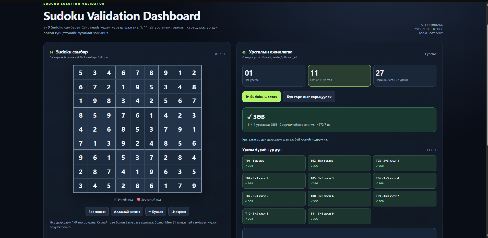
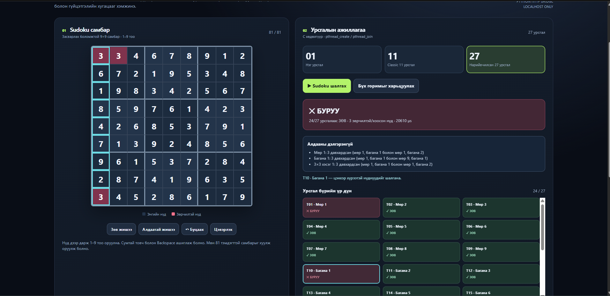
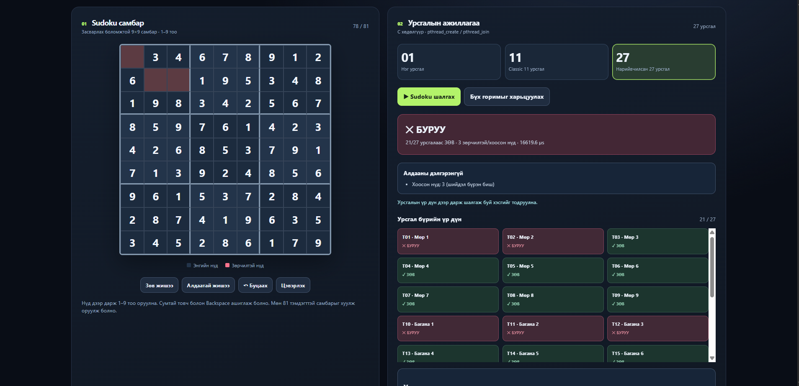
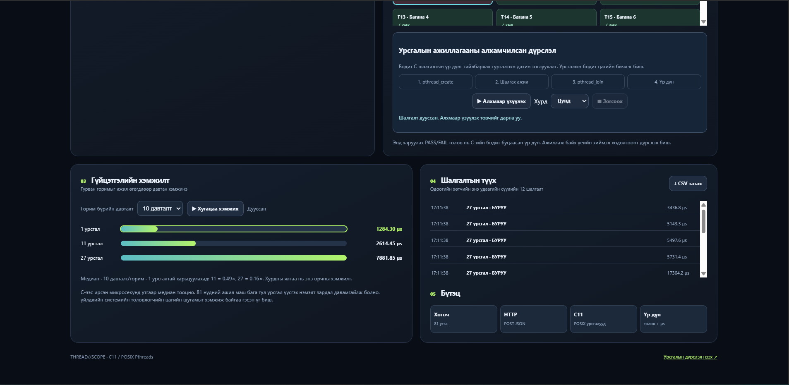

# Шүүмж: IV-2-5 Sudoku Solution Validator

## 1. Ажлын ойлголт

IV-2-5 баг сурах бичгийн 4-р бүлгийн (Threads & Concurrency) Programming Project 1 буюу Sudoku Solution Validator-ийг C11 хэл, POSIX Pthreads сан ашиглан хэрэгжүүлжээ. 9×9 самбарын 9 мөр, 9 багана, 9 дэд хүснэгт буюу нийт 27 бүсийг 1, 11, 27 урсгалын гурван горимоор шалгадаг. 11 урсгалын горим нь номд санал болгосон хувилбар (бүх мөр 1, бүх багана 1, дэд хүснэгт бүрд 1 урсгал) юм.

Номын шаардлагын дагуу эх урсгал шалгах байрлалыг `parameters` бүтцээр `pthread_create()`-д дамжуулж, i-р урсгал зөвхөн `valid[i]`-д бичнэ. Эх урсгал `pthread_join()`-оор бүгдийг хүлээгээд массивыг нэгтгэж эцсийн шийдвэр гаргана. Бүс бүрийг 10 битийн маскаар шалгаж, маск `0x3FE` бол 1..9 цифр бүгд байгаа гэж үздэг.

Үүн дээр файл, stdin, санамсаргүй үүсгэгч, алдаа оруулагчаар оролт бэлтгэх CLI сонголтууд, горимуудын хурдыг харьцуулах `-b`, мөн зөвхөн localhost дээр ажиллах Python HTTP гүүр болон хөтчийн Dashboard нэмжээ. Dashboard нь самбарыг засаж, C программаар шалгуулж, урсгал бүрийн үр дүнг харуулдаг. Тусдаа `ui/sudoku_threads.html` хуудас нь CPU-ийн хуваарийг загварчилсан сургалтын симулятор бөгөөд бодит хэмжилт биш гэдгийг баг өөрөө тодорхой бичсэн.

Шүүмжийг GitHub дээрх `main` салбарын `64d77b5` commit (2026-11-01) болон `v1.0.0` tag (`38ef527`, 2026-10-30) дээр хийсэн. Тайлан, Manual-ийг Teams-ийн постонд хавсаргасан PDF-ээс уншсан.

## 2. Туршилтын орчин

| Зүйл | Утга |
|---|---|
| Компьютер | x86_64, 12 логик цөм, Windows 11 |
| OS | WSL2, Debian GNU/Linux 13 (trixie), kernel 6.18.33.2-microsoft-standard-WSL2 |
| Compiler | gcc 14.2.0 (Debian), GNU Make |
| Runtime | Python 3.13.5 (зөвхөн стандарт сан) |
| Браузер | Google Chrome (Windows), `http://127.0.0.1:8765/dashboard.html` |
| Шалгасан хувилбар | `main` дээрх `64d77b5`, мөн `v1.0.0` tag |

Manual-д Linux дээр эх кодоос ажиллуулах замыг өгсөн тул бид WSL2 доторх Debian ашигласан. Тэд 2 vCPU-тэй Linux дээр хэмжсэн бол манай орчин 12 цөмтэй. Иймээс хугацааны тоон утга ялгаатай гарах нь хэвийн бөгөөд бид зөвхөн дүгнэлт нь давтагдах эсэхийг шалгав.

## 3. Build ба Run

Manual-ийн 2.2 ба 2.4 хэсгийн алхмыг хоосон хавтсанд шинээр clone хийж гүйцэтгэв.

```
git clone https://github.com/sumya4748-afk/Sudoku-Thread-Validator.git
cd Sudoku-Thread-Validator
make
make test
python3 -m unittest discover -s tests -v
python3 server.py
```

Үр дүн:

- `make` нэг удаагийн оролдлогоор амжилттай болж, `-Wall -Wextra` тугтай байхад анхааруулга гараагүй.
- `make test` нь ThreadSanitizer-ийн хэсэг дээр 134-139 алдаатай дууссан (ажиллуулах бүрт тоо нь өөр). Шалтгаан нь кодын алдаа биш, орчны асуудал бөгөөд 7.2 хэсэгт дэлгэрэнгүй бичив. ASLR-ийг `setarch -R`-ээр унтраахад **2170/2170** шалгалт давсан нь тайлангийн тоотой яг таарна.
- `python3 -m unittest` 13 тестээс 12 нь давж, 1 нь орчноос хамааран алгасагдсан.
- `python3 server.py` асаад Windows дээрх Chrome-оос `127.0.0.1:8765` хаягаар Dashboard нээгдсэн.

Бүтэн гаралтыг `review/IV-2-5_make_test_log.txt` файлд хавсаргав.

## 4. Туршилт

### 4.1 Үндсэн тест

Тайлан болон Manual-д бичсэн үр дүнг давтав.

| № | Команд / нөхцөл | Хүлээгдсэн | Бодит | Дүгнэлт |
|---|---|---|---|---|
| 1 | `./sudoku_validator` (Figure 4.26), горим 1, 11, 27 | Зөв, код 0 | ЗӨВ, код 0, `valid[]` бүгд 1 | Тэнцсэн |
| 2 | `-t 27 -f tests/invalid_one_cell.txt` | Мөр 1, багана 1, дэд хүснэгт 1 нь 0 | `valid[]` дээр 0, 9, 18-р байрлал 0, код 1 | Тэнцсэн |
| 3 | `-t 27 -f tests/invalid_subgrids_only.txt` | Зөвхөн сүүлийн 9 нь 0 | Яг тийм | Тэнцсэн |
| 4 | `make test` (`setarch -R`-тэй) | 2170 шалгалт давна | 2170/2170 | Тэнцсэн |
| 5 | `python3 -m unittest discover -s tests` | Бүгд давна | 13 тест, OK (1 алгассан) | Тэнцсэн |
| 6 | `-b 2000 -f tests/valid_fig426.txt` | Урсгал нэмэгдэхэд хугацаа өснө | 248.3, 1024.2, 3235.7 µs (4.13×, 13.03×) | Дүгнэлт давтагдсан |

Тайланд 2 vCPU орчинд 1, 11, 27 урсгалын дундаж хугацаа 35.1, 253.0, 649.0 µs гэж гарсан. Бидний орчинд тоо нь ялгаатай ч "энэ хэмжээний ажилд урсгал үүсгэх зардал давамгайлж, олон урсгал удаашруулдаг" гэсэн гол дүгнэлт давтагдсан.

### 4.2 Нэмэлт тест

Багийн тестэд ороогүй гэж бодсон нөхцлүүдийг өөрсдөө нэмж шалгав.

| № | Оролт / нөхцөл | Хүлээгдсэн | Бодит | Дүгнэлт |
|---|---|---|---|---|
| E1 | Тестэд ороогүй өөр зөв самбар (Wikipedia-гийн жишээ), 3 горим | Зөв | ЗӨВ, код 0 | Тэнцсэн |
| E2 | Нэг мөрийн эхний 2 нүдийг солих | Мөр, дэд хүснэгт зөв, багана 1, 2 буруу | 27 горимд яг багана 1, 2 нь 0 | Тэнцсэн |
| E3 | Латин квадрат: мөр, багана бүгд зөв, дэд хүснэгт буруу | 11 горимд эхний 2 урсгал 1, 9 дэд хүснэгт 0 | `[1 1 0 0 0 0 0 0 0 0 0]` | Тэнцсэн |
| E4 | 81 нүд бүгд 0 | Буруу | БУРУУ, бүх урсгал 0 | Тэнцсэн |
| E5 | 82 цифртэй файл, 9×8 хэмжээтэй файл, хоосон файл | Код 2, ойлгомжтой мессеж | Код 2, мессеж тодорхой | Тэнцсэн |
| E6 | Windows (CRLF) мөрийн төгсгөлтэй файл | Зөв уншина | ЗӨВ | Тэнцсэн |
| E7 | 100 KB санамсаргүй binary файл | Код 2, crash гарахгүй | Код 2 | Тэнцсэн |
| E8 | `-s 9,9,9`, `-e 81`, `-s` 82 удаа | Буруу, буруу, алдаа | Код 1, 1, 2 | Тэнцсэн |
| E9 | API: 3 горим, нэг нүд хоосон, латин квадрат | C-тэй ижил дүн | Ижил, `badCells` зөв | Тэнцсэн |
| E10 | API: `mode: 5`, 80 нүд, 10 утга, `true` болон `5.0` утга, `[1,2]` body | 400 | 400 | Тэнцсэн |
| E11 | API: буруу Host, буруу Origin, Content-Type биш, 9000 byte body | 403, 403, 415, 400 | Яг тийм | Тэнцсэн |
| E12 | `/server.py`, `/sudoku_validator.c`, `/../etc/passwd`, URL-кодлосон `../server.py` | Хандах эрхгүй | 404 | Тэнцсэн |
| E13 | `v1.0.0` tag дээр `-b 1 -f tests/invalid_one_cell.txt` | Код 1 | **Код 0** | **Тэнцээгүй** (7.1) |
| E14 | `v1.0.0` tag дээр `-s 1,1,6junk` | Код 2 | **Алдаагүй ажиллаж ЗӨВ гэсэн** | **Тэнцээгүй** (7.1) |

`main` салбар дээрх 12 нэмэлт тест бүгд тэнцсэн. Тэнцээгүй хоёр тест нь зөвхөн Release хийсэн `v1.0.0` хувилбарт хамаарна.

## 5. Дүрслэлийн үнэлгээ

Багшийн өгсөн шаардлага нь "Sudoku хүснэгт оруулах, validation ажиллуулах, мөр, багана, дэд хүснэгтийн шалгалтыг ялган харуулах самбартай байх, урсгалуудын үр дүнг ажиглаж болох" юм. Dashboard энэ шаардлагыг бүрэн хангаж байна.



11 урсгалын горимд "Бүх мөр", "Бүх багана" болон 9 дэд хүснэгтийн урсгал тус тусдаа харагдаж, тоо нь C программын `valid[]` массивтай таарч байна.



"Алдаатай жишээ" нь [1,1] нүдийг 3 болгодог. 27 урсгалын горимд Мөр 1, Багана 1, 3×3 хэсэг 1 гэсэн яг 3 урсгал БУРУУ болж, 24/27 гэж гарсан нь C-ийн гаралттай таарна. Урсгал дээр дарахад тухайн урсгалын шалгадаг нүднүүд цэнхэр хүрээгээр тодордог нь аль урсгал аль бүсийг шалгадгийг ойлгоход маш тус болсон.



Хоосон нүдийг алдаатай гэж тооцож, нөлөөлсөн мөр, багана, дэд хүснэгтийн урсгалууд (21/27) зөв тодорсон.



Хугацааны графикт 1 урсгал хамгийн хурдан гарсан нь тайлангийн дүгнэлттэй нийцэж байна. Нэг жижиг ажиглалт: Dashboard харьцааг "1 урсгалын хугацаа / тухайн горимын хугацаа" (11 = 0.49×) гэж, харин CLI-ийн `-b` нь эсрэгээр "тухайн горимын хугацаа / 1 урсгалын хугацаа" (11 = 4.13×) гэж хэвлэдэг. Хоёуланг нь нэг тодорхойлолтоор харуулбал уншигч андуурахгүй.

Dashboard-ийн "Алхмаар үзүүлэх" хэсэг болон симуляторын хуудас нь бодит урсгалын дарааллыг биш, үр дүнг дахин тоглуулдаг гэдгийг UI дээр шууд бичсэн нь шударга, зөв шийдэл гэж үзэв.

## 6. Давуу тал

1. **Номын шаардлагыг яг дагасан, зөв хэрэгжилт.** `parameters` бүтэц, `valid[i]`, `pthread_join()` гурав нь номд заасан механизмаар хийгдсэн. Бидний 3 горим дээр хийсэн бүх тест, түүний дотор мөр, багана зөв боловч дэд хүснэгт буруу латин квадрат зөв илэрсэн (E2, E3).
2. **Data race-гүйг онол болон хэрэгслээр нотолсон.** Урсгал бүр зөвхөн өөрийн `valid[i]`, `reports[i]`-д бичдэг тул mutex хэрэггүйг Бернштейний нөхцлөөр тайлбарлаж, ThreadSanitizer-ээр баталсан. Бидний орчинд ч TSan, ASan, UBSan алдаа илрүүлээгүй.
3. **Оролтын шалгалт ба тест маш нарийн.** 2170 автомат шалгалт, хатуу аргумент parse, BOM, CRLF, binary файл зэрэг бүх захын тохиолдолд код 2 болон ойлгомжтой мессеж гарсан (E5..E8).
4. **HTTP гүүрийн хамгаалалт сайн.** Зөвхөн 127.0.0.1 дээр сонсох, Host ба Origin шалгах, Content-Type, хэмжээ, зэрэг хүсэлтийн тоо, C процессын timeout зэрэг хязгаарыг бүгдийг нь бид туршиж баталсан (E10..E12). Зөвхөн хоёр HTML файл нийтэд нээлттэй, бусад файлд хандах боломжгүй.
5. **Гүйцэтгэлийн шинжилгээ гүнзгий.** Дулаан, хүйтэн хэмжилт, цөмийн тооны нөлөө, Амдалын хууль, шугаман загвар, 11 урсгалын ачааллын тэнцвэргүй байдал (81 ба 9 нүд) зэргийг тайланд тоон баримттай тайлбарласан.

## 7. Асуудал

### 7.1 Release болон репо дахь баримт илгээсэн ажилтай таарахгүй (Major)

**Нөхцөл.** БД1 удирдамжаар 9-р долоо хоногт нийтэлсэн хувилбар Release/Tag-тай байх ба `docs/` хавтсанд Manual байх ёстой.

**Давтах алхам.**

```
git clone --branch v1.0.0 https://github.com/sumya4748-afk/Sudoku-Thread-Validator.git
cd Sudoku-Thread-Validator && make
./sudoku_validator -q -b 1 -f tests/invalid_one_cell.txt; echo $?
./sudoku_validator -q -s 1,1,6junk; echo $?
git log --oneline v1.0.0..main | wc -l
```

**Хүлээгдсэн үр дүн.** Release хийсэн хувилбар нь тайлан, Manual-д тайлбарласан программ байна. Буруу Sudoku-д код 1, буруу аргументад код 2 буцаана.

**Бодит үр дүн.**

- `v1.0.0` (2026-10-30) нь `main`-аас 69 commit хоцорсон. Тэдгээр commit 10-31, 11-01-нд нэмэгдсэн ч шинэ tag гараагүй.
- `v1.0.0` дээр `-b` горимд буруу Sudoku өгөхөд хүснэгтэд "БУРУУ" гэж хэвлэсэн ч гаралтын код **0** буцаадаг. `-s 1,1,6junk` гэсэн буруу аргументыг `sscanf` алдаагүй хүлээж аваад "ЗӨВ" гэж дуусдаг. Хоёулаа дараа нь `main` дээр засагдсан (`da3ff02`, `b617649`).
- Тайлангийн "2170 автомат шалгалт" нь `main` дээрх тоо. `v1.0.0` дээр 2159 шалгалт ажиллав.
- Репоны `docs/Report.pdf`, `docs/Manual.pdf` нь тус бүр 2 хуудастай эхний ноорог (10-30). Тэнд "239 шалгалт", "TSan, ASan алгасагдсан", "хамгаалалтаас өмнө screenshot, GitHub release, гишүүдийн хувь нэмрийг нэмнэ" гэж бичсэн. 33 хуудас тайлан ба 8 хуудас Manual зөвхөн Teams-ийн постонд байна.
- Teams-ийн пост "Windows дээр GitHub Releases-ээс бэлэн EXE" гэж заадаг ч тэр нь `windows-latest` гэсэн хөдөлгөөнт tag бөгөөд аль эх кодоос build хийснийг тогтоох боломжгүй.

**Нөлөө.** Шүүмжлэгч болон багш "илгээсэн ажил" гэж аль хувилбарыг үнэлэхээ тодорхойлж чадахгүй. Release-ээр татсан хүн тайланд "засагдсан" гэсэн алдаатай кодыг авна. Скрипт эсвэл CI нь гаралтын кодоор дүгнэдэг тул `-b` горимын алдаа нь буруу Sudoku-г зөв гэж үзэхэд хүргэнэ. Репо дотор эцсийн тайлан, Manual байхгүй тул Teams-гүйгээр репог үзсэн хүн ноорог баримтыг л харна.

### 7.2 Manual-ийн дагуу make test нь шинэ kernel дээр унадаг (Minor)

**Нөхцөл.** ASLR-ийн `vm.mmap_rnd_bits` өндөр (kernel 6.x-ийн олон түгээлтийн анхдагч тохиргоо) орчин.

**Давтах алхам.** Manual-ийн 2.4 хэсгийн дагуу `make test` ажиллуулна.

**Хүлээгдсэн үр дүн.** Тайлангийн дагуу 2170 шалгалт давна.

**Бодит үр дүн.** ThreadSanitizer-ийн binary `FATAL: ThreadSanitizer: unexpected memory mapping` гэж унаж, 134-139 шалгалт амжилтгүй болно (тоо нь ажиллуулах бүрт өөр). `setarch x86_64 -R make test` гэж ASLR-ийг унтраахад бүгд давсан.

**Нөлөө.** Энэ нь кодын алдаа биш, TSan-ийн мэдэгдэж буй хязгаарлалт юм. Гэхдээ Manual-ийн алхмыг дагасан шүүмжлэгч зуу гаруй FAIL харж, программыг буруу гэж дүгнэх магадлалтай. Known issues хэсэгт "Sanitizer тест орчноос хамаарна" гэж бичсэн ч шалтгаан, засах аргыг өгөөгүй.

### 7.3 Алдаатай нүдийг C урсгалууд биш Python болон JavaScript тооцдог (Minor)

**Нөхцөл.** Dashboard дээр алдаатай самбар шалгах.

**Бодит байдал.** Эцсийн дүн (`valid`) болон урсгал бүрийн `ok` нь C программаас ирдэг. Харин улаанаар тодруулах нүднүүдийг (`badCells`) `server.py` дотор, "Алдааны дэлгэрэнгүй" жагсаалтыг `dashboard.html`-ийн `describeIssues()` дотор тус тусад нь дахин тооцдог. C код өөрөө урсгал бүрийн `worker_report.issues`-д давхардсан, дутуу цифр болон нүдний байрлалыг цуглуулдаг ч UI түүнийг ашигладаггүй. Ингэснээр нэг дүрэм гурван газар (C, Python, JavaScript) бичигдсэн байна. Манай тестэд гурвын үр дүн зөрөөгүй (E9).

**Нөлөө.** Одоогоор буруу үр дүн гараагүй ч UI-ийн хамгийн их харагддаг хэсэг болох "аль нүд алдаатай вэ" гэдэг нь урсгалуудын ажлын үр дүн биш болж байна. Цаашид C-ийн дүрэм өөрчлөгдвөл (жишээ нь 0-ийг хоосон биш алдаа гэж ялгах) UI зөрөх эрсдэлтэй.

## 8. Сайжруулах санал

| Асуудал | Санал |
|---|---|
| 7.1 Release | `main`-ийн одоогийн commit дээр `v1.0.1` (эсвэл `v1.1.0`) tag тавьж, 33 хуудас тайлан ба 8 хуудас Manual-ийг `docs/`-д оруулж Release-д хавсаргах. Windows ZIP-ийг тухайн tag-аас build хийж, хөдөлгөөнт `windows-latest`-ийн оронд хувилбарын дугаартай Release-д байршуулах. Teams-ийн постонд аль tag-ийг үнэлэхийг заах. |
| 7.2 make test | `run_tests.sh` дотор TSan binary "unexpected memory mapping" гэж унавал `setarch x86_64 -R`-ээр дахин ажиллуулах, эсвэл Manual-ийн Known issues-д энэ алдааны мессеж, шалтгаан, `setarch -R` болон `sudo sysctl vm.mmap_rnd_bits=28` гэсэн засах аргыг бичих. |
| 7.3 UI | C программд JSON гаралтын горим (жишээ нь `-j`) нэмж, урсгал бүрийн `issues`-ийг (бүс, цифр, нүд) буцаах. `server.py` нь өөрөө тооцохгүйгээр түүнийг дамжуулж, Dashboard улаан нүд болон алдааны жагсаалтыг үүнээс зурах. Ингэвэл UI дээрх бүх мэдээлэл урсгалуудын бодит үр дүн болно. |

## 9. Дүгнэлт

IV-2-5-ийн ажил Sudoku Solution Validator-ийг номын шаардлагын дагуу зөв, data race-гүй хэрэгжүүлсэн, тест, оролтын шалгалт, HTTP гүүрийн хамгаалалт нь маш сайн ажил байна. Dashboard нь мөр, багана, дэд хүснэгт бүрийн урсгалыг ялгаж, сонгосон урсгалын шалгах нүдийг тодруулдаг нь багшийн өгсөн UI шаардлагыг бүрэн хангаж байна. Гүйцэтгэлийн дүгнэлт манай орчинд ч давтагдсан. `main` дээр хийсэн бидний 18 тест бүгд тэнцсэн, тэнцээгүй 2 тест нь зөвхөн `v1.0.0` Release-д хамаарна.

Сайжруулах гурван гол зүйл:

1. Release-ийг шинэчилж, эцсийн тайлан, Manual-ийг репо болон Release-д оруулах (7.1).
2. `make test`-ийн TSan алдааны шалтгаан, засах аргыг Manual болон тестийн скриптэд тусгах (7.2).
3. UI-ийн алдаатай нүд, алдааны жагсаалтыг C урсгалуудын гаргасан үр дүнгээс авах (7.3).

## Хавсралт A. Review маягт

| Үе шат | Команд | Хүлээгдсэн үр дүн | Бодит үр дүн |
|---|---|---|---|
| Build | `make` | `sudoku_validator` үүснэ | Амжилттай, анхааруулгагүй |
| Run | `python3 server.py` | Dashboard нээгдэнэ | Нээгдсэн, C хөдөлгүүр холбогдсон |
| Үндсэн тест | `make test` | 2170 давна | 134-139 TSan FAIL; `setarch -R`-тэй 2170/2170 |
| Үндсэн тест | Figure 4.26, `invalid_one_cell`, `invalid_subgrids_only` | 0, 1, 1 ба зөв `valid[]` | Яг тийм |
| Нэмэлт тест | Латин квадрат, хоосон самбар, буруу хэмжээ, binary файл | Зөв ялгана, crash гарахгүй | Тэнцсэн |
| Нэмэлт тест | API оролт ба хамгаалалт (E9..E12) | 400/403/404/415 | Тэнцсэн |
| Нэмэлт тест | `v1.0.0`: `-b` буруу Sudoku, `-s 1,1,6junk` | Код 1, код 2 | Код 0, код 0 |

| Priority | Асуудал | Нөлөө | Санал |
|---|---|---|---|
| Major | `v1.0.0` Release ба `docs/` PDF илгээсэн ажилтай таарахгүй | Үнэлэх хувилбар тодорхойгүй, Release-д засагдаагүй алдаа үлдсэн | Шинэ tag, эцсийн PDF-ийг репо ба Release-д оруулах |
| Minor | `make test` шинэ kernel дээр TSan-аар унадаг | Manual дагасан хүн 100+ FAIL харна | `setarch -R` болон шалтгааныг Manual, скриптэд тусгах |
| Minor | Алдаатай нүдийг C биш Python/JS тооцдог | UI-ийн гол мэдээлэл урсгалын үр дүн биш, цаашид зөрөх эрсдэлтэй | C-ээс урсгал бүрийн issues-ийг JSON-оор авах |
