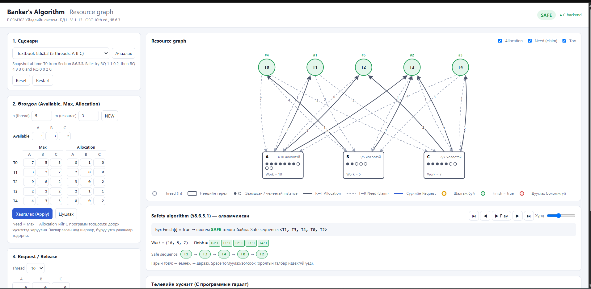
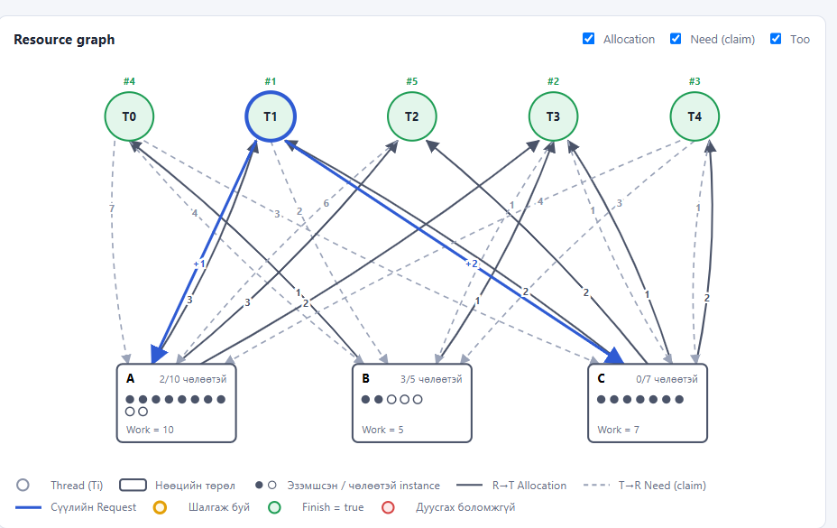
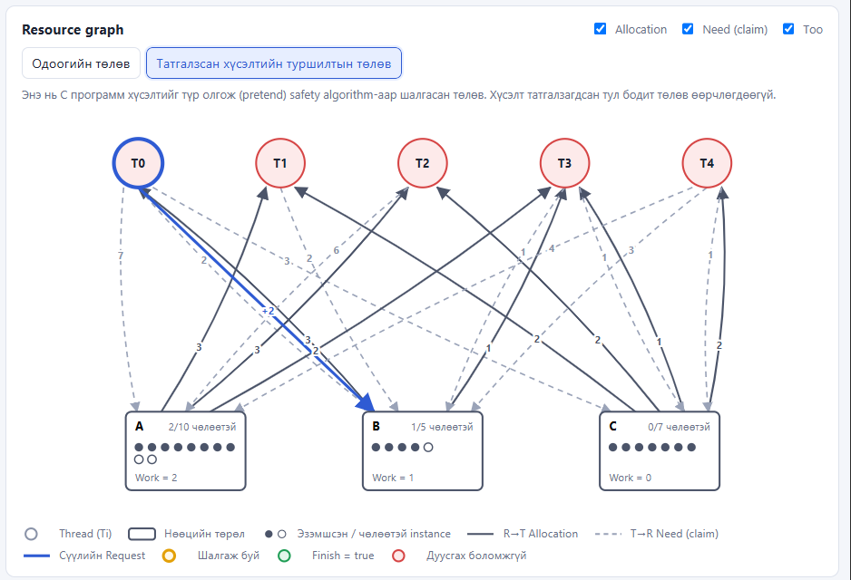
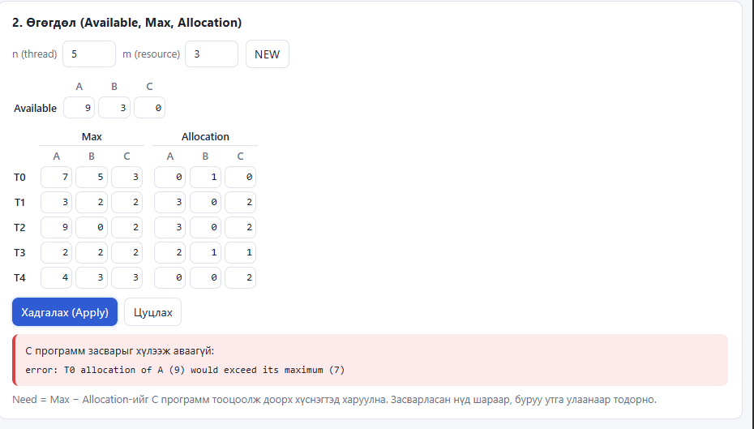
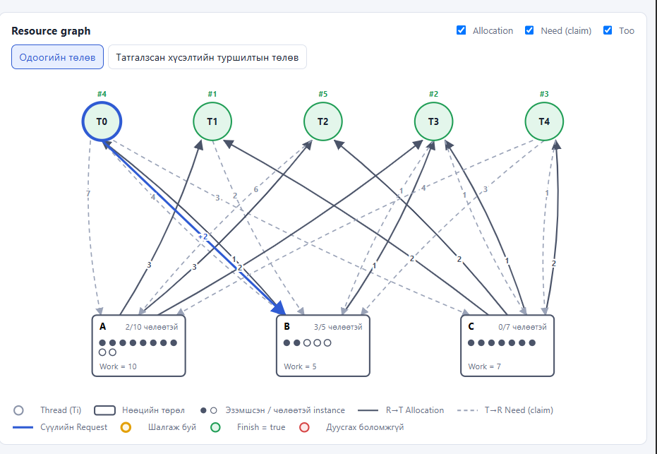

# Шүүмж: V-1-13 Banker's Algorithm

## 1. Ажлын ойлголт

V-1-13 баг сурах бичгийн 8-р бүлгийн (Deadlocks) Banker's Algorithm Programming Project-ийг C хэл дээр хэрэгжүүлжээ. Программ `./bin/banker 10 5 7 8` хэлбэрээр Available векторыг командын мөрөөс, Maximum матрицыг файлаас уншина. Дараа нь номд заасан `RQ`, `RL`, `*` командуудаар хүсэлт хүлээн авч, хүсэлт бүрийг олгосны дараах төлөв safe эсэхийг §8.6.3.1-ийн safety algorithm-аар шалгана. Unsafe болох хүсэлтийг буцааж, шалтгааныг нь хэвлэнэ.

Номын шаардлагаас гадна тэд Allocation файл ачаалах (`-a`), safety algorithm-ийн алхам бүрийг хэвлэх `SAFE`, төлөв засварлах `NEW`/`AVAIL`/`MAX`/`ALLOC`, `SAVE`/`RESET` командууд, мөн дараа нь §8.7.2-ын deadlock detection (`WAIT`/`DETECT`) нэмсэн байна.

UI нь Python стандарт сан дээрх жижиг сервер бөгөөд `bin/banker -j` процессыг ажиллуулж, JSON хариуг браузерт Resource graph болон алхамчилсан safety algorithm хэлбэрээр харуулдаг. Алгоритмыг JavaScript дээр дахин бичээгүй, бүх шийдвэрийг C программ гаргадаг нь зохиомжийн хамгийн зөв сонголт гэж бид үзсэн.

Шүүмжийг GitHub дээрх `main` салбарын `0a9ad37` commit дээр (2026-10-31) хийсэн. Репод tag байхгүй тул энэ commit-ийг илгээсэн хувилбар гэж үзэв.

## 2. Туршилтын орчин

| Зүйл | Утга |
|---|---|
| Компьютер | x86_64, Windows 11 |
| OS | WSL2, Debian GNU/Linux 13 (trixie), kernel 6.18.33.2-microsoft-standard-WSL2 |
| Compiler | gcc 14.2.0 (Debian), GNU Make |
| Runtime | Python 3.13.5 (зөвхөн стандарт сан) |
| Браузер | Google Chrome (Windows), `http://127.0.0.1:8000/` |
| Шалгасан хувилбар | `Energyshifter8/V-1-13-Bankers-Algorithm`, commit `0a9ad37` |

Manual-ийн 1.2 хэсэгт Windows хэрэглэгч WSL ашиглана гэж заасан тул бид ч WSL2 ашигласан. Тэд Arch Linux дээр туршсан бол бид Debian дээр туршсан. Энэ төсөл kernel module биш, энгийн хэрэглэгчийн программ тул WSL2 дээрх үр дүн бодит Linux-тай ялгаагүй гэж үзэж байна.

## 3. Build ба Run

Manual-ийн 1.3 болон 2.4 хэсгийн алхмыг өөрчлөлгүйгээр, хоосон хавтсанд шинээр clone хийж гүйцэтгэв.

```
git clone https://github.com/Energyshifter8/V-1-13-Bankers-Algorithm.git
cd V-1-13-Bankers-Algorithm
make
make test
python3 src/ui/server.py --port 8000
```

Үр дүн:

- `make` нэг удаагийн оролдлогоор амжилттай болж, `-Wall -Wextra -pedantic` тугтай байхад ч нэг ч анхааруулга гараагүй.
- `make test` ажиллуулахад unit тест 62/62, CLI тест 25/25, серверийн integration тест 8/8 давсан. Бүтэн гаралтыг `review/V-1-13_make_test_log.txt` файлд хавсаргав.
- Нэмэлт сан суулгах шаардлага гараагүй. Manual-д бичсэн `build-essential python3` хангалттай байсан.
- WSL доторх серверийг Windows дээрх Chrome-оос `127.0.0.1:8000` хаягаар шууд нээж чадсан.

Build ба Run хэсэгт ямар нэг саад гараагүй. Manual-ийн заавар бүрэн, ойлгомжтой байна.

## 4. Туршилт

### 4.1 Үндсэн тест

Номын жишээнүүдийг тайлангийн 8-р бүлэгт бичсэн үр дүнтэй тулгаж шалгав.

| № | Оролт / нөхцөл | Хүлээгдсэн | Бодит | Дүгнэлт |
|---|---|---|---|---|
| 1 | §8.6.3.3 эхний төлөв, `SAFE` | Safe | SAFE, `<T1, T3, T4, T0, T2>` | Тэнцсэн |
| 2 | `RQ 1 1 0 2` | Зөвшөөрнө, Available (2,3,0) | GRANTED, Available (2,3,0) | Тэнцсэн |
| 3 | Дараа нь `RQ 4 3 3 0` | Нөөц хүрэлцэхгүй | DENIED, resources are not available | Тэнцсэн |
| 4 | Дараа нь `RQ 0 0 2 0` | Unsafe тул татгалзана | DENIED, unsafe; туршилтын Available (2,1,0) | Тэнцсэн |
| 5 | §8.6.1, 12 instance, `RQ 2 1` | Unsafe тул татгалзана | DENIED, unsafe | Тэнцсэн |
| 6 | Номын project оролт `10 5 7 8`, `RQ 0 3 1 2 1` | Тайлангийн 9-р бүлгийн тайлбараар татгалзана | Эхнээсээ UNSAFE анхааруулга, DENIED | Тэнцсэн |
| 7 | §8.7.2 `WAIT` + `DETECT` | Эхэндээ deadlock-гүй, T2 нэмж хүсвэл T1..T4 гацна | Яг ийм гарсан | Тэнцсэн |

Safe sequence номд `<T1, T3, T4, T2, T0>` гэж өгөгдсөн ч программ `<T1, T3, T4, T0, T2>` олсон. Хоёулаа зөв бөгөөд баг үүнийг тайлангийн хэлэлцүүлэгт зөв тайлбарласан.

### 4.2 Нэмэлт тест

Багийн тестэд ороогүй гэж бодсон нөхцлүүдийг өөрсдөө нэмж шалгав.

| № | Оролт / нөхцөл | Хүлээгдсэн | Бодит | Дүгнэлт |
|---|---|---|---|---|
| E1 | `-fsanitize=address,undefined`-тай build хийж бүх тест | Санах ойн алдаагүй | 62/62, 25/25, ASan/UBSan мэдээлэл гараагүй | Тэнцсэн |
| E2 | `RQ 1 1 0 2`, `RL 1 1 0 2`, дараа нь `RQ 0 0 2 0` | Release-ийн дараа төлөв анхныхаа руу буцаж, T0-ийн хүсэлт олгогдоно | GRANTED, safe `<T3, T1, T2, T0, T4>` | Тэнцсэн |
| E3 | `RQ 3 1 1 1` (Need-ээс их) | Maximum claim хэтэрсэн | DENIED, exceeds remaining need | Тэнцсэн |
| E4 | `RQ 9 ...`, `RQ -1 ...`, `RL 2 9 9 9` | Ойлгомжтой алдаа, программ үргэлжилнэ | Тус бүр зөв мессеж | Тэнцсэн |
| E5 | `RQ 1 a b c`, `RQ 1 1 2 3 4` | Алдаа | invalid number, expects 3 values | Тэнцсэн |
| E6 | `RQ 0 99999999999 0 0` | Overflow-гүй алдаа | value is too large (max 1000000) | Тэнцсэн |
| E7 | 33 мөртэй Maximum файл, `3 3 2x` аргумент | Алдаа, exit 1 | too many customers (max 32); not a valid resource count | Тэнцсэн |
| E8 | Windows (CRLF) мөрийн төгсгөлтэй Maximum файл | Зөв уншина | Зөв уншсан | Тэнцсэн |
| E9 | Сервер: `QUIT`, мөр шилжүүлэх тэмдэгтээр команд нэмэх, `../` замаар файл унших | Хориглоно | 400, нэг л команд ажилласан, 404 | Тэнцсэн |
| E10 | UI: T0-ийн Max ба Allocation-ийг зэрэг засаж Allocation > Max болгоод Apply | Засвар бүхэлдээ татгалзагдаж, төлөв өөрчлөгдөхгүй | T0-ийн Allocation 0 болж, нийт B 5-аас 4 болсон | **Тэнцээгүй** (7.1) |

Нийт 17 тестээс 16 нь тэнцэж, нэг нь UI-ийн засварлагч дээр тэнцээгүй.

## 5. Дүрслэлийн үнэлгээ

UI-ийг номын §8.6.3.3 жишээгээр ачаалж, тайлан болон Manual-д заасан дарааллаар туршив.



Граф дээрх тоо бүр C программын төлөвтэй таарч байна. Жишээ нь A нөөцийн хайрцагт "3/10 чөлөөтэй" гэж бичигдсэн нь Available A = 3, Total A = 10-тай тэнцүү. Assignment edge (хатуу шугам) нь Allocation-ыг, claim edge (тасархай шугам) нь Need-ийг зөв заажээ. Legend байнга харагддаг нь тэмдэглэгээг ойлгоход тус болсон.



T1-ийн хүсэлтийн дараа A, C нөөц рүү цэнхэр `+1`, `+2` ирмэг гарч, чөлөөт instance-ийн тоо 2/10, 3/5, 0/7 болсон нь Available (2,3,0)-тай яг таарна.



Татгалзсан хүсэлтийн "туршилтын төлөв" нь энэ ажлын хамгийн сайн шийдэл гэж бид үзсэн. Хүсэлтийг түр олгосон төлөвт Work = (2,1,0) болох ба ямар ч thread-ийн Need энэ утгаас бага биш тул бүгд улаан болж байгаа нь "яагаад unsafe вэ" гэсэн асуултад шууд хариулж байна. Stepper-ийн товчоор алхам бүрийг урагш, хойш гүйлгэж шалгах боломжтой.

Дүрслэлийн хувьд бидний олсон хоёр асуудлыг 7-р хэсэгт тайлбарлав. Нэг нь засварлагчийн Apply товч (Зураг 4), нөгөө нь татгалзсан хүсэлтийн ирмэг (Зураг 5).

## 6. Давуу тал

1. **Алгоритм зөв, номтой бүрэн таарч байна.** `bank_is_safe()` ба `bank_request()` нь §8.6.3.1, §8.6.3.2-ын алхмуудыг яг дагасан бөгөөд unsafe үед төлөвийг бүрэн сэргээдэг. Номын 7 жишээ болон бидний нэмэлт CLI тестүүд бүгд зөв гарсан (4.1, 4.2).
2. **UI алгоритмыг давхардуулаагүй.** Бүх шийдвэрийг `bin/banker -j` гаргадаг тул CLI, тест, UI гурав нэг л кодыг ашигладаг. Иймээс UI буруу тооцоолох эрсдэл байхгүй. Консолд `*` бичихэд CLI-тэй яг ижил хүснэгт гарсан.
3. **Unsafe шалтгааныг харуулдаг.** Туршилтын төлөв ба stepper нь хэрэглэгчид зөвхөн "DENIED" гэхээс илүүтэй, аль алхам дээр гацсаныг харуулдаг (Зураг 3).
4. **Оролтын шалгалт ба тест чанартай.** Буруу тоо, сөрөг утга, overflow, хэт урт мөр, файлын алдаа бүрт ойлгомжтой мессеж гарч, программ нэг ч удаа унаагүй. Sanitizer-тэй build дээр ч алдаа гараагүй.
5. **Номын project оролтын алдааг илрүүлсэн.** Номын жишээ Maximum файлд T4 нь B нөөцөөс 6-г шаардах ч системд нийт 5 л байгаа тул төлөв эхнээсээ unsafe болохыг баг өөрсдөө олж, программд анхааруулга нэмжээ.

## 7. Асуудал

### 7.1 Apply товч алдаа өгсөн ч төлөвийг хэсэгчлэн өөрчилдөг (Major)

**Нөхцөл.** UI-ийн "2. Өгөгдөл" засварлагч дээр нэг thread-ийн Max болон Allocation-ийг зэрэг өөрчилж, Allocation нь шинэ Max-аас их болох үед.

**Давтах алхам.** Номын §8.6.3.3 жишээг ачаална. T0-ийн Max-ийн A-г 8 болгож, Allocation-ий A-г 9 болгоод Хадгалах (Apply) дарна.

**Хүлээгдсэн үр дүн.** C программ засварыг хүлээж аваагүй гэж мэдээлж байгаа тул төлөв засварын өмнөх хэвээрээ үлдэнэ.

**Бодит үр дүн.** UI "C программ засварыг хүлээж аваагүй" гэж улаан мэдэгдэл харуулдаг (Зураг 4). Гэтэл `app.js`-ийн `editorCommands()` нь засварыг `ALLOC 0 0 0 0`, `MAX 0 8 5 3`, `ALLOC 0 9 1 0` гэсэн гурван команд болгон дараалан илгээдэг. Эхний хоёр нь хэрэгжиж, гурав дахь нь алдаа өгнө. Үүний дараа сервер дээрх төлөвийг шалгахад:

```
ALLOC 0 0 0 0 -> ok
MAX 0 8 5 3   -> ok
ALLOC 0 9 1 0 -> error
after: Max0=8,5,3  Alloc0=0,0,0  Avail=3,3,2  Total=10,4,7
```

T0-д олгогдсон байсан (0,1,0) нөөц алга болж, B нөөцийн нийт тоо 5-аас 4 болсон. Мөн Available-ийн засвар ALLOC-оос өмнө илгээгддэг тул UI дээрх туршилтад Allocation алдаа өгсөн ч Available-ийн засвар (9,3,0) хэрэгжсэн хэвээр үлдсэн.



**Нөлөө.** Хэрэглэгч засвар хэрэгжээгүй гэж ойлгоод үргэлжлүүлэн туршихад төлөв аль хэдийн өөрчлөгдсөн, систем дэх нийт нөөц ч буурсан байна. Ийм төлөв дээрх safe/unsafe дүгнэлт хэрэглэгчийн оруулсан өгөгдөлтэй таарахгүй. Banker's algorithm-ийн UI-ийн гол зорилго нь "өгөгдөл өөрчилж safe state шалгах" тул энэ нь гол функцэд шууд нөлөөлж байна. Manual-ийн 2.8 хэсэгт "өмнөх засвар хэрэгжсэн хэвээр үлдэнэ" гэж товч дурдсан ч Allocation устаж нөөц багасна гэдгийг хэрэглэгч тэндээс ойлгохгүй.

### 7.2 Release tag байхгүй, илгээсний дараа `main` өөрчлөгдсөн (Major)

**Нөхцөл.** БД1 удирдамжаар GitHub репо Release tag-тай байх ёстой.

**Давтах алхам.** Репоны Releases, Tags хуудсыг нээх эсвэл `git tag` ажиллуулах.

**Хүлээгдсэн үр дүн.** `v1.0.0` гэх мэт tag, хавсаргасан PDF-тэй Release байна.

**Бодит үр дүн.** Tag ч, Release ч байхгүй. `30b325d` commit-ийн мессеж "drop v1.0 tag references" гэж байгаа ч Manual-ийн толгойд "Хувилбар: v1.0" гэсэн хэвээр байна. Teams-ийн пост 10-28-нд орсон боловч 10-30, 10-31-нд `main` салбарт deadlock detection (`WAIT`/`DETECT`) болон 2 шинэ тест нэмэгдсэн.

**Нөлөө.** Шүүмжлэгч болон багш аль хувилбарыг илгээсэн, аль нь дараа нэмэгдсэнийг ялгах боломжгүй. Илгээсэн PDF нь 10-28-ны кодыг, харин репо 10-31-ний кодыг тайлбарлаж байгаа тул хоёр баримт зөрчилдөж байна. Жишээ нь илгээсэн тайлангийн 1-р бүлэгт "Deadlock detection алгоритм (§8.7) хамрахгүй", CLI тест 23 гэж бичсэн ч репод detection хэрэгжсэн, CLI тест 25 байна. `docs/REPORT.md`-г шинэчилсэн ч PDF-ийг дахин үүсгээгүй (`git log`: PDF сүүлд 10-28-нд, `REPORT.md` 10-31-нд өөрчлөгдсөн).

### 7.3 Татгалзсан хүсэлтийн ирмэг зөвшөөрөгдсөнтэй адилхан зурагддаг (Minor)

**Давтах алхам.** §8.6.3.3 жишээ дээр `RQ 1 1 0 2`, дараа нь `RQ 0 0 2 0` хийж "Одоогийн төлөв" графыг харах.

**Хүлээгдсэн үр дүн.** T0-ийн хүсэлт татгалзагдсан тул одоогийн төлөвийн граф дээр олголт харагдахгүй, эсвэл татгалзсан гэдгийг өөр хэлбэрээр ялгаж харуулна.

**Бодит үр дүн.** T0-оос B руу цэнхэр бүдүүн `+2` сум зурагддаг. Энэ нь Зураг 2 дээрх зөвшөөрөгдсөн T1-ийн ирмэгтэй өнгө, хэлбэрээрээ яг адилхан (Зураг 5). B-ийн чөлөөт тоо 3/5 хэвээр байгаа тул төлөв зөв ч дүрслэл нь эсрэг утга илэрхийлж байна.



**Нөлөө.** Хүсэлтийн панелийг харахгүйгээр зөвхөн графыг харсан хэрэглэгч T0-д нөөц олгогдсон гэж буруу ойлгох магадлалтай.

## 8. Сайжруулах санал

| Асуудал | Санал |
|---|---|
| 7.1 Apply | Засварлагчийн бүх утгыг эхлээд JavaScript дээр шалгах (Allocation <= Max нүд бүрт), алдаа байвал нэг ч команд илгээхгүй байх. Эсвэл `server.py`-ийн `/api/batch` нь batch эхлэхээс өмнөх төлөвийг хадгалж, алдаа гарвал `AVAIL`/`MAX`/`ALLOC` командуудаар тэр төлөвийг сэргээх. Хамгийн найдвартай нь C талд нэг командаар бүх засварыг шалгаад дараа нь хэрэгжүүлэх (transaction) байдлаар хийх. Энэ тохиолдлыг `tests/test_ui_server.py`-д тест болгон нэмэх. |
| 7.2 Release | 10-28-нд илгээсэн commit (`30b325d` эсвэл түүний дараах docs commit) дээр `v1.0.0` tag тавьж, тухайн үеийн PDF-ийг хавсаргасан Release гаргах. Deadlock detection-ийг `v1.1.0` болгон тусад нь гаргаж, `make docs`-оор PDF-ийг дахин үүсгээд Release-д хавсаргах. Manual-ийн толгой дахь хувилбарын дугаарыг tag-тай тааруулах. |
| 7.3 Ирмэг | Татгалзсан хүсэлтийг улаан тасархай шугам, "татгалзсан" шошготой зурах, эсвэл одоогийн төлөвийн граф дээр зөвхөн зөвшөөрөгдсөн хүсэлтийг харуулж, татгалзсаныг туршилтын төлөвт л зурах. Legend-д мөн энэ тэмдэглэгээг нэмэх. |

## 9. Дүгнэлт

V-1-13-ийн ажил Banker's algorithm-ийг зөв, номд нийцүүлэн хэрэгжүүлсэн, тест болон оролтын шалгалт нь сайн, Manual-ийн дагуу ямар ч саадгүй build хийгдэж ажилласан чанартай ажил байна. Unsafe шалтгааныг алхамчлан харуулдаг UI нь алгоритмыг ойлгоход үнэхээр тус болдог. Бидний шалгасан 17 тестээс 16 нь тэнцсэн.

Сайжруулах гурван гол зүйл:

1. UI-ийн Apply товч алдаа гарсан үед төлөвийг хэсэгчлэн өөрчилж, нөөц устгадаг асуудлыг засах (7.1).
2. Илгээсэн хувилбарт Release tag тавьж, PDF-ийг репоны одоогийн кодтой тааруулах (7.2).
3. Татгалзсан хүсэлтийг граф дээр зөвшөөрөгдсөнөөс ялгаж харуулах (7.3).

## Хавсралт A. Review маягт

| Үе шат | Команд | Хүлээгдсэн үр дүн | Бодит үр дүн |
|---|---|---|---|
| Build | `make` | `bin/banker` үүснэ | Амжилттай, анхааруулгагүй |
| Run | `python3 src/ui/server.py --port 8000` | UI нээгдэнэ | Нээгдсэн, SAFE, "C backend" тэмдэгтэй |
| Үндсэн тест | `make test` | Бүгд давна | 62/62, 25/25, 8/8 |
| Үндсэн тест | §8.6.3.3: `RQ 1 1 0 2`, `RQ 4 3 3 0`, `RQ 0 0 2 0` | Granted, wait, unsafe | Яг тийм |
| Нэмэлт тест | ASan/UBSan build + бүх тест | Алдаагүй | Алдаагүй |
| Нэмэлт тест | Буруу оролт E3..E9 | Ойлгомжтой алдаа | Тэнцсэн |
| Нэмэлт тест | UI Apply, Max+Allocation, Allocation > Max | Төлөв өөрчлөгдөхгүй | Allocation устсан |

| Priority | Асуудал | Нөлөө | Санал |
|---|---|---|---|
| Major | Apply алдаа өгсөн ч төлөвийг хэсэгчлэн өөрчилдөг | Нөөц устаж, safe/unsafe дүгнэлт буруу өгөгдөл дээр гарна | Илгээхээс өмнө шалгах, эсвэл алдаа гарвал сэргээх |
| Major | Release tag байхгүй, илгээсний дараа `main` өөрчлөгдсөн | Илгээсэн хувилбар тодорхойгүй, PDF ба код зөрнө | `v1.0.0`, `v1.1.0` tag, PDF-ийг дахин үүсгэх |
| Minor | Татгалзсан хүсэлтийн ирмэг зөвшөөрөгдсөнтэй адил | Графаас буруу дүгнэлт хийх магадлалтай | Улаан тасархай шугам, тусдаа legend |
