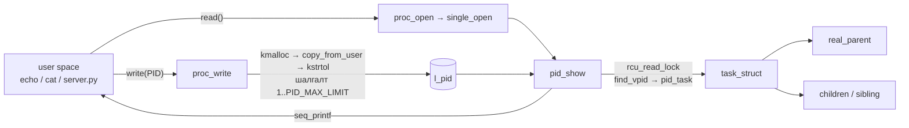
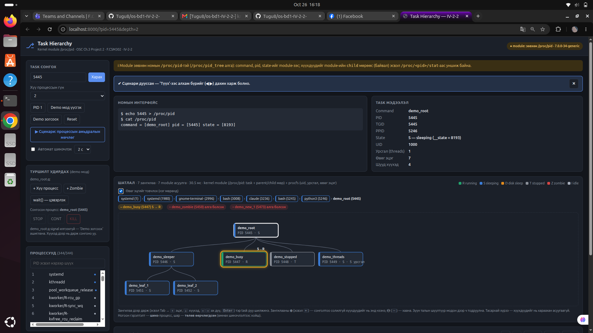
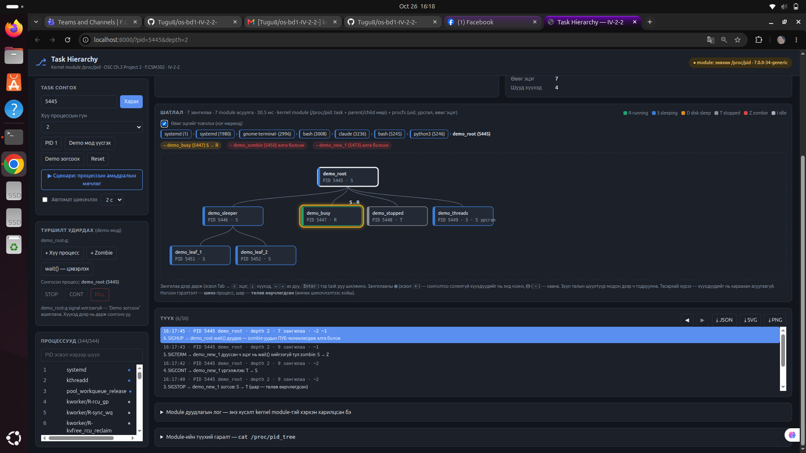

# Тайлангийн kernel module хэсэг — B242270047 (Kernel module)

> `docs/TASKS.md`: *"Тайлангийн "Хэрэгжилт" хэсгийг kernel module болон UI хариуцсан гишүүд өөрсдөө бичиж өгнө."*
> Энэ файлыг тайлан хариуцсан **B232270108** (Report.pdf) ашиглана. Хэсгийн дугаарууд нь `OS_BD1_Guide.pdf`-ийн §7 тайлангийн бүтэцтэй тохирно. UI-ийн хэсэг: [../ui/REPORT_UI.md](../ui/REPORT_UI.md).

---

## 2. Сурах бичгийн шаардлага

OSC (2018), 3-р бүлэг, Programming Project 2 "Linux Kernel Module for Task Information" (P-15–P-17):

1. `/proc/pid` файл үүсгэнэ.
2. Хэрэглэгч `echo "1395" > /proc/pid` гэж PID бичнэ. Module үүнийг `kmalloc` + `copy_from_user`-ээр kernel санах ой руу хуулж, `kstrtol`-оор тоо болгон хадгална.
3. `cat /proc/pid` уншихад тухайн task-ийн `command`, `pid`, `state`-ийг хэвлэнэ. Task-ийг `pid_task(find_vpid(pid), PIDTYPE_PID)`-ээр олно.
4. Байхгүй PID бол `find_vpid` NULL буцаана, энэ үед алдаа гаргахгүйгээр юу ч хэвлэхгүй.

Манай module эдгээр дээр **parent болон children** мөрүүдийг нэмсэн. Учир нь багшийн оноосон UI дүрслэл нь task hierarchy (parent – task – children мод) юм.

## 3. Онолын үндэс (module-д хамаарах хэсэг)

| Ойлголт | Module-д хаана гарч ирэх |
|---|---|
| PCB = `struct task_struct` | Task бүрийн мэдээлэл: `comm` (нэр), `__state`, `real_parent`, `children`, `sibling` |
| Процессын мод | `real_parent` заагч дээш, `children` жагсаалт доош; хүүхдүүд хоорондоо `sibling` талбараар холбогдсон давхар холбоост жагсаалт |
| `/proc` файлын систем | Санах ойд л байдаг виртуал файл. Унших/бичих бүрт kernel-ийн функц дуудагдана |
| Kernel ба user space | Хэрэглэгчийн заагчийг шууд уншиж болохгүй. `copy_from_user` хаягийг шалгаж байж хуулна |
| PID namespace | Нэг task өөр өөр namespace-д өөр PID-тэй байж болно. `find_vpid` / `task_pid_vnr` нь бичиж/уншиж буй процессын namespace-ийн PID-ийг ашиглана |

## 4. Системийн зохиомж — module-ийн бүтэц



| Функц | Үүрэг |
|---|---|
| `pid_init` / `pid_exit` | `insmod` хийхэд `proc_create("pid", 0666, ...)`, `rmmod` хийхэд `remove_proc_entry` |
| `proc_write` | Оролтыг шалгаж, PID-ийг глобал `l_pid`-д хадгална |
| `proc_open` | `single_open(file, pid_show, NULL)` — `seq_file` холбоно |
| `pid_show` | Task, parent, children-ийг `seq_printf`-ээр хэвлэнэ |
| `pid_proc_ops` | `struct proc_ops`: open, read (`seq_read`), write, lseek (`seq_lseek`), release (`single_release`) |

### Гаралтын формат

```
command = [bash] pid = [1395] state = [1]
parent = [gnome-terminal-] ppid = [1200]
child = [vim] pid = [1400] state = [1]
child = [sleep] pid = [1402] state = [1]
```

Эхний мөр нь номын форматтай яг ижил. `parent` болон `child` мөрүүд нь нэмэлт бөгөөд UI (`server.py`-ийн `BookBackend`) эдгээрийг задалж мод байгуулдаг. Байхгүй PID бол гаралт хоосон (read 0 байт).

## 5. Хэрэгжилт

### 5.1 Write — PID хүлээн авах

```c
if (count == 0 || count > MAX_INPUT_LEN)      /* MAX_INPUT_LEN = 32 */
	return -EINVAL;
k_mem = kmalloc(count + 1, GFP_KERNEL);
copy_from_user(k_mem, usr_buf, count);
k_mem[count] = '\0';
ret = kstrtol(k_mem, 10, &val);
kfree(k_mem);
if (val <= 0 || val > PID_MAX_LIMIT)
	return -EINVAL;
l_pid = val;
```

- Номын skeleton-оос ялгаатай нь оролтын уртыг хязгаарласан. Хэрэглэгч их хэмжээний өгөгдөл бичээд kernel-ийн санах ойг дүүргэж чадахгүй.
- `k_mem[count] = '\0'` — `copy_from_user` мөрийн төгсгөл тавьдаггүй тул өөрсдөө тавина.
- `kstrtol` нь `sscanf`-аас хатуу: `abc`, `12abc`, хоосон оролтыг `-EINVAL`, хэт том тоог `-ERANGE` гэж буцаана. Төгсгөлийн `\n`-ийг (echo-ийн гаралт) зөвшөөрнө.
- PID 0 (idle task) болон сөрөг тоог, мөн `PID_MAX_LIMIT`-ээс (4194304) их тоог татгалзана.
- Алдаа гарвал `l_pid` өөрчлөгдөхгүй, өмнөх PID хэвээр үлдэнэ. Хэрэглэгчид `echo: write error: Invalid argument` гэж харагдана.
- `kmalloc`-оор авсан санах ойг бүх замд `kfree` хийнэ (санах ой алдагдахгүй).

### 5.2 Read — task мэдээлэл хэвлэх

```c
rcu_read_lock();
task = pid_task(find_vpid(l_pid), PIDTYPE_PID);
if (!task)
	goto out;
seq_printf(m, "command = [%s] pid = [%d] state = [%u]\n",
	   task->comm, task_pid_vnr(task), READ_ONCE(task->__state));
parent = rcu_dereference(task->real_parent);
...
list_for_each_entry_rcu(child, &task->children, sibling)
	seq_printf(m, "child = [%s] pid = [%d] state = [%u]\n", ...);
out:
rcu_read_unlock();
```

- **`seq_file` ашигласан шалтгаан.** Номын skeleton `proc_read` дотор `completed` туг ашиглаж, нэг удаа л буфер руу бичдэг. Хүүхэд олонтой task (жишээ нь PID 1) байвал гаралт нэг буферт багтахгүй байж болно. `seq_file` нь буферийг өөрөө томруулж, `offset`, дахин уншихыг зөв зохицуулдаг.
- **RCU түгжээ.** `find_vpid`, `pid_task` нь RCU-ийн дор дуудагдах ёстой. Мөн `children` жагсаалтыг гүйх хооронд task дуусч устахаас сэргийлнэ. `real_parent`-ийг `rcu_dereference`-ээр уншина.
- **`parent != task` шалгалт.** Зөвхөн PID 0 (idle task)-ийн parent нь өөрөө байдаг. Write үүнийг аль хэдийн татгалздаг ч хамгаалалт болгон үлдээсэн.
- **`READ_ONCE(task->__state)`.** Төлөв өөр CPU дээр өөрчлөгдөж байж болох тул нэг удаа уншина.

### 5.3 Kernel хувилбарын ялгаа

| Номын skeleton (kernel 4.x) | Манай module | Шалтгаан |
|---|---|---|
| `struct file_operations` | `struct proc_ops` | Kernel 5.6-аас `/proc`-д тусдаа бүтэц ашиглана |
| `task->state` | `task->__state` | Kernel 5.14-д нэрийг өөрчилсөн (шууд хандахаас сэргийлэх зорилгоор) |
| `proc_read` + `completed` | `seq_read` + `single_open` | Дээрх 5.2 |
| `task->pid` | `task_pid_vnr(task)` | PID namespace (5.4) |

Тиймээс module kernel ≥ 5.14 дээр compile хийгдэнэ.

### 5.4 PID namespace (B190910014-ийн засвар, `3234d12`)

Анх `task->pid` (global PID) хэвлэдэг байсан. Container эсвэл тусдаа PID namespace дотроос бичихэд `find_vpid` тухайн namespace-ийн PID-ээр хайдаг ч хэвлэх PID нь global болж зөрдөг байсан. Одоо `task_pid_vnr`-ээр бичигчийн namespace-ийн PID-ийг хэвлэдэг тул оролт, гаралт ижил namespace-д байна.

### 5.5 Commit түүх

| Commit | Агуулга |
|---|---|
| `790d165` | Write: `/proc/pid` руу бичсэн PID-ийг задлах |
| `bb5551f` | Read: command, pid, state хэвлэх (номын формат) |
| `121dc29` | `seq_file` руу шилжүүлж, parent ба children мөр нэмэх |
| `99541ac` | Хязгаараас гадуурх PID-ийг татгалзах |
| `3234d12` | PID namespace-д тохирсон PID хэвлэх (B190910014) |

## 7. Туршилтын арга (module-ийн хэсэг)

```bash
cd src/kmod && make
sudo insmod pid.ko
echo $$ > /proc/pid && cat /proc/pid      # өөрийн shell
echo 1 > /proc/pid && cat /proc/pid       # init: олон child
sudo rmmod pid && sudo dmesg | tail -2    # "/proc/pid created" / "removed"
```

| Оролт | Хүлээгдсэн үр дүн |
|---|---|
| Ажиллаж буй bash-ийн PID | `command = [bash] ...`, parent нь терминал, child нь тухайн үед ажиллаж буй командууд |
| `1` | `command = [systemd]`, `parent = [swapper/0] ppid = [0]`, олон `child` мөр |
| Байхгүй PID (`999999`) | Write амжилттай, read хоосон |
| `abc`, `-5`, `0`, хоосон мөр | `write error: Invalid argument`, өмнөх PID хэвээр |
| `99999999` (> `PID_MAX_LIMIT`) | `Invalid argument` |
| 32 байтаас урт мөр | `Invalid argument` |
| Kernel thread (`2`, kthreadd) | Мэдээлэл гарна, олон kernel thread child |

### 7.1 Bare-metal дээрх бодит үр дүн

Туршсан орчин: Ubuntu 24.04.5 LTS (bare-metal, dual boot, `systemd-detect-virt` = `none`), kernel `7.0.0-34-generic`, gcc 13.3.0, Secure Boot унтраалттай. Бүрэн гаралт: [`tests/kmod_baremetal.txt`](../../tests/kmod_baremetal.txt).

| Оролт | Бодит үр дүн | Таарсан эсэх |
|---|---|---|
| bash-ийн PID (`sleep 300 &`-ийн дараа) | `command = [bash] ... state = [1]`, `child = [sleep] ... state = [8193]` | ✔ |
| `1` | `command = [systemd]`, `parent = [swapper/0] ppid = [0]`, 33 `child` мөр | ✔ |
| `2` | `command = [kthreadd]`, `parent = [swapper/0] ppid = [0]`, 224 `child` мөр | ✔ |
| `999999` | Write амжилттай, read 0 байт | ✔ |
| `abc`, `-5`, `0`, хоосон мөр, `12abc` | `write error: Invalid argument`, өмнөх PID хэвээр | ✔ |
| `99999999` | `Invalid argument` | ✔ |
| 33 тэмдэгттэй мөр (34 байт) | `Invalid argument` | ✔ |
| `echo -n 1` (`\n`-гүй) | Хүлээж авна | ✔ |
| `' 1'` (урд талдаа зайтай) | `Invalid argument` — `kstrtol` урд талын зайг зөвшөөрдөггүй | ✔ |
| `src/ui/contract_check.py` | 17 ✔, 1 ⚠ (`/proc/pid_tree` байхгүй — UI `book` горимоор ажиллана), 0 ✖ | ✔ |

`insmod` хийхэд `module verification failed: signature and/or required key missing - tainting kernel` гэсэн анхааруулга гарсан. Энэ нь гарын үсэггүй module ачаалсныг л тэмдэглэдэг, ажиллагаанд нөлөөлөхгүй.

UI-г мөн ижил машин дээр module-тэй хамт ажиллуулсан (`book` горим):





Тестийн скриптүүдийн (B231910003) бодит гаралт `tests/*/result_*.txt`-д, терминалын screenshot нь `docs/images/term_tests_pass.png`-д байна.

## 9. Хэлэлцүүлэг — хязгаарлалт

- `l_pid` нь бүх хэрэглэгчид нэг глобал хувьсагч. Хоёр процесс зэрэг бичиж/уншвал бие биеийнхээ PID-ийг дарж болно. UI энэ асуудлаас `server.py`-ийн мутексээр (`_module_lock`) сэргийлдэг, харин терминалаас зэрэг ажиллуулбал зөрж болно.
- `0666` эрхтэй тул ямар ч хэрэглэгч PID бичиж чадна. Гэхдээ зөвхөн `/proc/<pid>/stat`-д аль хэдийн нээлттэй мэдээллийг харуулдаг.
- `state` нь `__state`-ийн тоон утга бөгөөд битийн маск юм (`0` = running, `1` = interruptible, `2` = uninterruptible, `4` = stopped). Бусад flag-тай нийлж том тоо гарч болно. Туршилтад `8193 = TASK_INTERRUPTIBLE | TASK_FREEZABLE` (sleep), `260 = __TASK_STOPPED | TASK_WAKEKILL` (SIGSTOP хийсэн процесс) гарсан. Үүнтэй адилаар `258 = TASK_UNINTERRUPTIBLE | TASK_WAKEKILL` гэх мэт утга ч гарч болно. Үсгэн тайлбарыг (`S`, `R`, `D`, `T`) UI `/proc/<pid>/stat`-аас авдаг.
- Kernel < 5.14 дээр (`__state` байхгүй) compile хийгдэхгүй.
- Kernel module ажиллуулахад `linux-headers-$(uname -r)` хэрэгтэй. Анхдагч WSL2 kernel-д энэ багц байхгүй.
