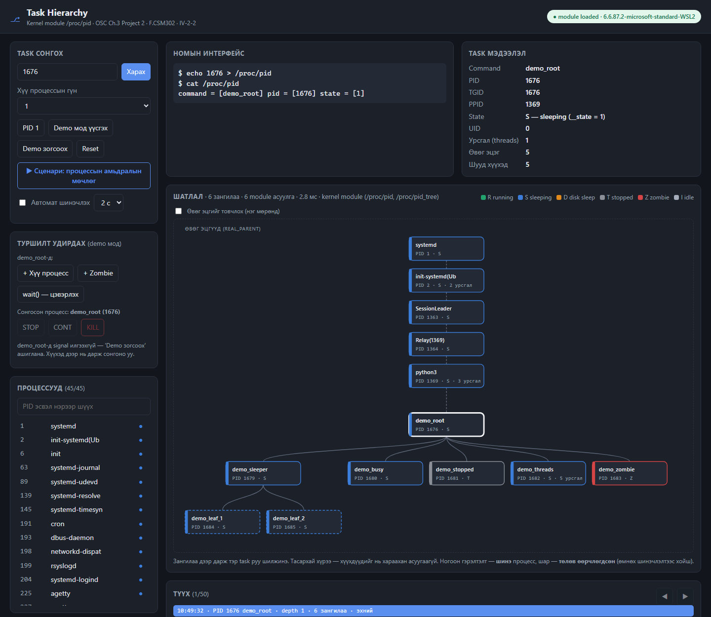
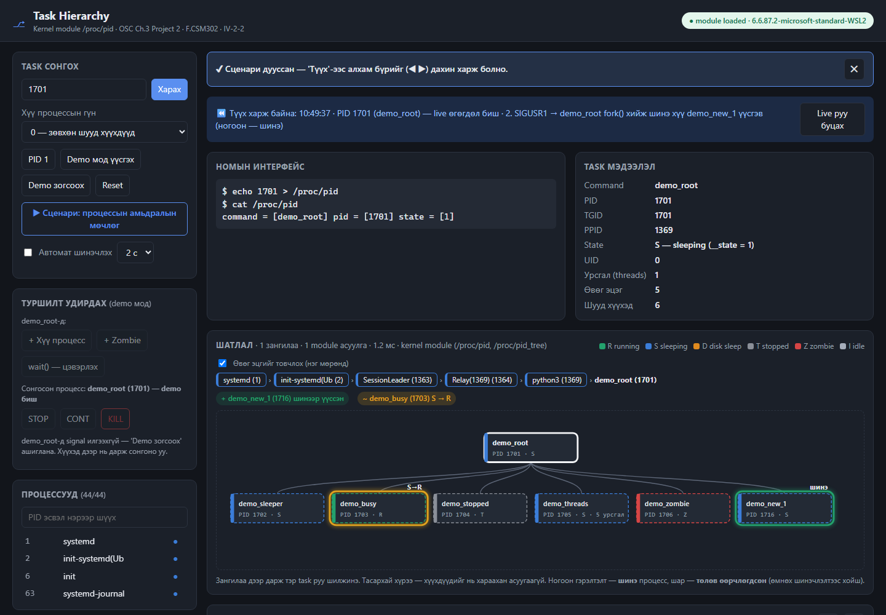
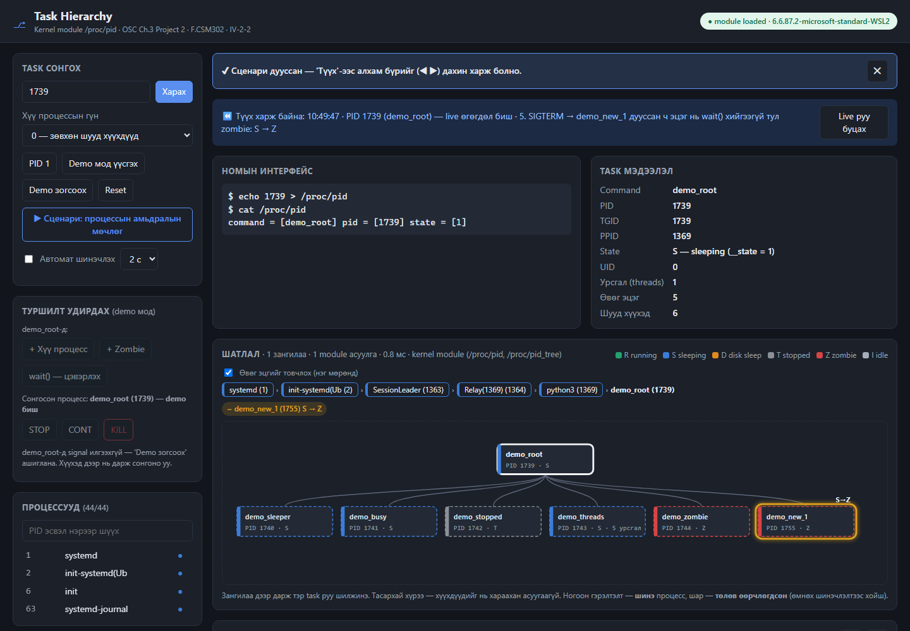
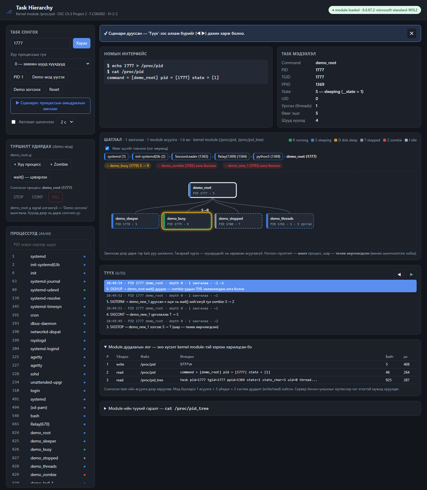
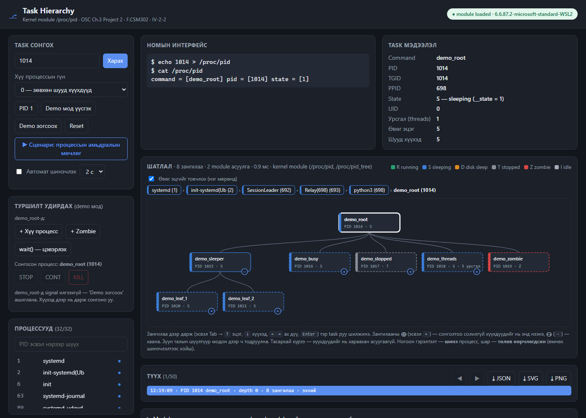

# src/ui — Task Hierarchy UI

**Хариуцагч:** B190910014 · `docs/TASKS.md`-ийн дагуу: PID оруулах/сонгох, task hierarchy мод зурах, state-ийг өнгөөр ялгах, refresh/reset, алдааны мэдэгдэл. Kernel module-тай `/proc/pid`-ээр холбогдоно.

Зөвхөн **Python 3 стандарт сан** + браузер (HTML/CSS/JS, гадны санггүй) — нэмэлт суулгац шаардлагагүй.

## Ажиллуулах

```bash
sudo insmod src/kmod/pid.ko            # kernel module (src/kmod — B242270047)
python3 src/ui/server.py               # → http://localhost:8000
python3 src/ui/server.py --port 9000   # өөр порт
python3 src/ui/server.py --fallback    # module хараахан бэлэн биш үед (доорхыг үз)
python3 src/ui/contract_check.py       # module нь UI-тай нийцэх эсэх (34 шалгалт, доорхыг үз)
```
WSL2 дээр Windows-ийн браузераас шууд `http://localhost:8000` нээгдэнэ. Зогсоох: `Ctrl+C`.

## Боломжууд

| Боломж | Хаана |
|---|---|
| PID оруулах (талбар + Enter), процессын жагсаалтаас сонгох/шүүх, модны зангилаа дээр дарах | зүүн самбар, мод |
| Номын интерфейс: `echo N > /proc/pid; cat /proc/pid`-ийн бодит гаралт | "Номын интерфейс" карт |
| Task мэдээлэл: command, PID, TGID, PPID, state (тэмдэгт + `__state`), UID, урсгалын тоо | "Task мэдээлэл" карт |
| **Task hierarchy мод** (SVG): өвөг эцгийн гинж (PID 1 хүртэл) → сонгосон task → хүү процессууд (гүн 0–4) | "Шатлал" |
| State-ийн өнгө: R ногоон, S цэнхэр, D улбар шар, T саарал, Z улаан, I цайвар + legend | мод, жагсаалт |
| Refresh: автомат шинэчлэх (1/2/5 с) — жнь R↔S өөрчлөлт харагдана | зүүн самбар |
| **Өөрчлөлтийг тодруулах:** шинэчлэлт бүрийг өмнөхтэй харьцуулна — шинэ процесс (ногоон + "шинэ"), төлөв өөрчлөгдсөн (шар + "S→T"), алга болсон (улаан chip) | мод, "Шатлал"-ын дээр |
| **Түүх, алхамчлал:** snapshot бүр (сүүлийн 50) — ◀ ▶ эсвэл дарж эргэн харах, "Live руу буцах" | "Түүх" |
| **▶ Сценари:** процессын амьдралын мөчлөг — fork → SIGSTOP (T) → SIGCONT → SIGTERM (Z, эцэг wait() хийгээгүй) → wait() (Z арилна), алхам бүр тайлбартай Түүхэнд | зүүн самбар |
| **Туршилт удирдах:** demo_root-д `+ Хүү процесс` (fork), `+ Zombie`, `wait() — цэвэрлэх`; сонгосон demo процесст STOP / CONT / KILL — **зөвхөн demo процессын бүлэгт** (бусад PID → 403) | "Туршилт удирдах" |
| **Module дуудлагын лог:** хүсэлт бүрийн write `/proc/pid` → read `/proc/pid` → read `/proc/pid_tree` (байт, µs) — UI бодит module-ийг ашигладгийн нотолгоо | доод хэсэг |
| Өвөг эцгийг товчлох — гинжийг нэг мөр (дарж болох) болгоно; том мод самбарт багтахаар жижгэрнэ (60% хүртэл); ≥ 7 навч хүүхдийг 6 баганатай сүлжээнд | "Шатлал" |
| **Газар дээр нь нээх:** тасархай зангилааны **⊕** — сонгосон task-ийг солилгүй тэр процессын хүүхдүүдийг нэг түвшнээр нээнэ, **⊖** — хаана (zombie-д ⊕ гарахгүй, хүүхэдгүй бол "хүүхэдгүй"); нээх/хаах нь "шинэ процесс" гэж тодрохгүй | мод |
| **Экспорт:** `⤓ JSON` — бүх түүх (тайлбар, diff, `/proc/pid_tree`-ийн түүхий гаралт, дуудлагын лог); `⤓ SVG` — одоогийн мод бие даасан зураг; `⤓ PNG` — 2× тод зураг (Word, Teams, постерт шууд) | "Түүх" |
| **Гарын товч:** Tab → <kbd>↑</kbd> эцэг, <kbd>↓</kbd> эхний хүүхэд, <kbd>←</kbd><kbd>→</kbd> ах дүү, <kbd>Enter</kbd> сонгох, <kbd>+</kbd> / <kbd>−</kbd> газар дээр нь нээх / хаах; зангилаа бүр `aria-label`, `aria-expanded`-тай | мод |
| **Хайлт:** зүүн талын шүүлтүүр модон дээр таарсан зангилааг тодруулж, бусдыг бүдгэрүүлнэ ("модонд N таарсан") | мод |
| Reset: бүх төлөв, түүхийг цэвэрлэнэ | зүүн самбар |
| Demo мод: мэдэгдэж буй бүтэцтэй туршилтын процессууд (S, R/S, T, Z, 5 урсгалтай) — `demo_tree.py`; сервер зогсоход (kill -9 ч) өөрөө цэвэрлэгдэнэ | "Demo мод үүсгэх / зогсоох" |
| Алдааны мэдэгдэл: буруу оролт (`abc`, `-5`, хэт том), байхгүй PID, module ачаалагдаагүй; сүлжээний түр алдаанд нэг удаа дахин оролдож өмнөх дүрслэлийг хадгална | улаан banner |
| Module-ийн түүхий гаралт (`cat /proc/pid_tree`) — дүрслэл бодит өгөгдөлтэй нийцэхийг шалгах | доод хэсэг |
| URL параметр: `?pid=1&depth=2&expand=12,34&auto=1&raw=1&calls=1&compact=1&demo=1&scenario=1&view=N` — шууд холбоос, screenshot | |

## Screenshot (бодит, module ачаалсан — WSL2 6.6.87.2)

| | |
|---|---|
|  |  |
| Demo мод (depth=1): T, Z, 5 урсгал, өвөг эцгийн гинж | Сценари 2-р алхам: `demo_new_1` шинээр үүссэн (ногоон), `demo_busy` S→R |
|  |  |
| 5-р алхам: SIGTERM → `demo_new_1` S→Z (эцэг wait() хийгээгүй) | 6-р алхам: wait() → zombie-ууд алга; тайлбартай Түүх, Module дуудлагын лог |
|  | |
| Газар дээр нь нээх: depth 0, `demo_sleeper` ⊖ (нээсэн) — сонголт `demo_root` хэвээр; товчилсон өвөг эцэг; zombie-д ⊕ байхгүй | |

## Kernel module-тай тохирох интерфейс (санал — `src/kmod`-тай тохиролцоно)

UI нь **номын интерфейс** `/proc/pid`-ийг яг номын дагуу ашиглана. Модыг зурахын тулд parent болон children хэрэгтэй тул (TASKS.md: *"Parent болон children жагсаалтыг гаргадаг өргөтгөл"*) нэмэлт **`/proc/pid_tree`**-ийг доорх форматаар уншина:

```
$ echo 1395 > /proc/pid          # PID-ийг /proc/pid эсвэл /proc/pid_tree руу бичнэ
$ cat /proc/pid
command = [bash] pid = [1395] state = [1]
$ cat /proc/pid_tree
task     pid=1395 tgid=1395 ppid=1300 state=1 state_char=S uid=1000 threads=1 comm=bash
ancestor pid=1300 tgid=1300 ppid=1 state=1 state_char=S uid=0 threads=1 comm=sshd
ancestor pid=1 tgid=1 ppid=0 state=1 state_char=S uid=0 threads=1 comm=systemd
child    pid=1400 tgid=1400 ppid=1395 state=0 state_char=R uid=1000 threads=1 comm=ls
summary  ancestors=2 children=1 truncated=0
```

| Мөр | Утга |
|---|---|
| `task` | Сонгосон task (яг 1 мөр) |
| `ancestor` | `real_parent`-ээр дээш — эцэг эхэнд, PID 1 сүүлд |
| `child` | `task->children` (`sibling` холбоос) — шууд хүү процессууд |
| `summary` | тоо, `truncated=1` бол хүүхдийн жагсаалт хязгаараас хэтэрсэн |

Талбарууд: `pid`/`tgid`/`ppid` — **бичсэн процессын namespace**-ийн дугаар (`task_pid_vnr`, WSL/контейнер дотор `ps`-тэй таарахын тулд), `state` — `__state`, `state_char` — `task_state_to_char()`, `uid`, `threads` — `signal->nr_threads`, `comm` — **мөрийн төгсгөлд** (нэр зай агуулж болно). Хүчингүй PID бол хоёр файл хоёулаа **0 байт** (номын шаардлага).

> Формат өөр байвал зөвхөн `server.py`-ийн `parse_tree_output()`-ийг өөрчилнө — UI-ийн бусад хэсэг JSON дээр ажилладаг.

**Синхрончлол:** module нэг *глобал* PID хадгалдаг тул хоёр хүсэлт зэрэг "бичих → унших" хийвэл нэг нь нөгөөгийнхийг уншиж болно. Сервер `threading.Lock()`-оор бичих+уншихыг нэг эгзэгтэй мужид оруулна (`src/ui/tests/test_api.py::test_10`).

## Backend горим (автоматаар сонгоно)

| Горим | Хэзээ | Өгөгдөл хаанаас | UI-д |
|---|---|---|---|
| `module` | `/proc/pid` + `/proc/pid_tree` | бүгд module-ээс | ногоон "● module loaded" |
| `book` | зөвхөн номын `/proc/pid` | command, pid, `__state` — **module**; эцэг/хүүгийн холбоо, uid, урсгал — `/proc/<pid>/stat` | шар шошго + ℹ banner; дуудлагын логт procfs мөр тусдаа |
| `fallback` | module байхгүй, `--fallback` өгсөн | бүгд `/proc/<pid>/stat` | "⚠ Нөөц горим … kernel module биш", номын мөрөнд `(fallback)` |

`book` горимын зорилго: kmod эхлээд зөвхөн номын үндсэн даалгаврыг (`/proc/pid`) хийсэн ч UI мод зурж ажиллана — интеграцийн эрсдэлийг бууруулна. Module байхгүй, `--fallback`-гүй → **503**; `/proc/pid` номын формат биш мөр буцаавал → **502** (буруу дүрслэхгүй, `contract_check.py`-г санал болгоно). `fallback` нь UI хөгжүүлэлтэд зориулсан — эцсийн туршилт, screenshot-ыг module ачаалсан үед хийнэ.

## Module-ийг шалгах — `contract_check.py` (kmod-д)

```bash
sudo insmod src/kmod/pid.ko
python3 src/ui/contract_check.py       # ✔ / ⚠ / ✖ хүснэгт; ✖ байвал exit 1 (UI серверийг зогсоогоод)
```
Жинхэнэ процессуудаар (скрипт өөрөө, хүү `sleep` S ба T, zombie хүү, нэмэлт урсгал) шалгана: номын формат, `pid` = бичсэн PID (namespace), `command`, `__state` бит (S → `TASK_INTERRUPTIBLE` 1, T → `__TASK_STOPPED` 4 — `sleep`-ийнх 8193 = 1 | `TASK_FREEZABLE`), байхгүй PID → 0 байт, 5 буруу оролт, **8 байтаар хэсэгчлэн унших** (count, `*pos`; буфер 4096 тул module илүү хуулсан ч скрипт эвдрэхгүй, илрүүлнэ), `/proc/pid_tree`-ийн мөр бүр UI-ийн `parse_tree_output()`-оор уншигдах, ancestor гинж PID 1 хүртэл тасралтгүй, child жагсаалт = procfs, S/T/Z, `threads`, `summary`.

Хэмжсэн үр дүн (WSL2 6.6.87.2):

| Module | ✔ | ⚠ | ✖ | Илэрсэн |
|---|---|---|---|---|
| `src/kmod/pid.c` (kmod-proposal, засварын өмнө) | 33 | 0 | **1** | 8 байтаар уншихад мөр `command ` дээр тасарна — `if (*pos > 0) return 0;` → kmod-proposal-д зассан |
| `src/kmod/pid.c` (засварын дараа) | **34** | 0 | 0 | — |
| `tests/book_modules/book_ok.ko` (зөвхөн `/proc/pid`, зөв) | 15 | 1 | 0 | `/proc/pid_tree` алга → UI `book` горим |
| `tests/book_modules/book_naive.ko` (номын skeleton-ий хэв маяг) | 12 | 1 | **3** | global PID (WSL-д PID 1 = 1451), count-оос 37 байт илүү `copy_to_user`, `sscanf` нь `abc`-г хүлээн авч хуучин PID-ийг уншуулна |

## API (server.py)

| Endpoint | Хариу |
|---|---|
| `GET /api/status` | `mode` (`module` / `book` / `fallback` / null), `module_loaded` (`/proc/pid` бий эсэх), `tree_file`, backend, кернел, demo root |
| `GET /api/task?pid=N&depth=D[&expand=A,B]` | `book_line`, `task`, `ancestors[]`, `tree` (D түвшин + `expand` дахь зангилааг нэг түвшнээр), `expand`, `raw`, `mode`, `nodes`, `queries`, `elapsed_ms` · алдаа: 400 (буруу оролт, `expand` > 64), 404 (байхгүй PID), 502 (`/proc/pid` формат буруу), 503 (module байхгүй) |
| `GET /api/processes` | `[{pid, ppid, comm, state_char}]` — сонгох жагсаалт |
| `POST /api/demo`, `POST /api/demo/stop` | туршилтын процессын мод эхлүүлэх / зогсоох |
| `POST /api/demo/spawn` · `/zombie` · `/reap` | demo_root-д SIGUSR1 (fork шинэ хүү) · SIGUSR2 (шууд дуусах хүү → Z) · SIGHUP (wait() → Z цэвэрлэх) |
| `POST /api/demo/signal?pid=N&sig=STOP\|CONT\|TERM` | demo процесст signal; demo биш → **403**, demo_root / өөр signal → 400, demo ажиллаагүй → 409 |

`/api/task`-ийн хариунд мөн `calls` (module-тэй хийсэн write/read бүр), `demo_root`, зангилаа бүрт `demo` (тухайн процесс demo бүлгийнх эсэх) байна.

## Тест

```bash
python3 -m unittest -v src/ui/tests/test_api.py    # 24 тест; module байхгүй бол fallback горимоор
node --test src/ui/tests/test_tree.mjs             # 12 тест — модны байрлал, diff, экспорт (Node 18+, заавал биш)
```
| № | Шалгах зүйл |
|---|---|
| 01–09 | статус, PID 1 (номын формат), demo модны бүтэц (5 хүүхэд, Z/T, 5 урсгал), depth=0, буруу оролт → 400, байхгүй PID → 404, буруу depth, процессын жагсаалт, static/path traversal |
| 10 | 2 урсгал × 15 зэрэг хүсэлт — бүгд өөрийн PID (мутекс) |
| 11 | гүний түвшин: depth=1 → хүүхдүүд асуугдсан, ач нар навч |
| 12 | Module дуудлагын лог: write `/proc/pid` → read `/proc/pid` → read `/proc/pid_tree` |
| 13 | demo тэмдэглэгээ (demo мод = true, PID 1 = false) |
| 14 | `+ Хүү процесс` → demo_new_N, `+ Zombie` → Z |
| 15 | амьдралын мөчлөг: STOP → **T**, CONT → S/R, TERM → **Z**, wait() → алга, zombie 0 |
| 16 | аюулгүй байдал: PID 1 руу signal → **403**, demo_root → 400, KILL signal → 400, `abc` → 400 |
| 17–18 | задлагч: номын мөр (тоо/үсэг state, `comm`-д `]`, буруу формат → None), `/proc/pid_tree`-д зай, `=`, `\|` агуулсан `comm` |
| 19–21 | горим: `fallback`, module-гүй → 503, `/proc/pid` формат буруу → 502 (зам түр сольж, module-оос үл хамаарна) |
| 22 | `book` горим = `module` горим: PID 1-ийн task талбарууд, хүүхдүүд, өвөг эцгийн гинж ижил (module шаардлагатай) |
| 23 | газар дээр нь нээх: depth=0 + `expand=demo_sleeper` → зөвхөн тэр зангилаа нээгдэж, ач нар навч (2 module асуулга); модонд байхгүй PID-ийг үл тооно |
| 24 | буруу `expand` (`abc`, `1,,2`, `-3`, 65 PID) → 400 |

Туршсан: WSL2 Ubuntu 22.04 (kernel 6.6.87.2) — `pid.ko` ачаалсан **24/24**, `book_ok.ko` (book горим) **23/23** + 1 алгассан, module-гүй (fallback) **23/23** + 1 алгассан. Node **12/12**.

## Файлууд

| Файл | Агуулга |
|---|---|
| `server.py` | HTTP сервер, JSON API, `/proc/pid` ба `/proc/pid_tree` задлагч, backend горим (module / book / fallback), мутекс, demo удирдлага |
| `contract_check.py` | Module ↔ UI интерфейсийн шалгагч (34 шалгалт) — kmod-ийн хөгжүүлэгчид |
| `static/index.html`, `app.js`, `style.css` | UI: төлөв, түүх, сценари, туршилт удирдах, SVG зурах, legend |
| `static/tree.js` | DOM-гүй логик: `layoutTree()` (tidy tree + олон навчийг сүлжээ), `diffTrees()` |
| `demo_tree.py` | Туршилтын процессын мод (`demo_root` → sleeper/busy/stopped/threads/zombie) |
| `tests/test_api.py` | API, задлагч, горимын тест (unittest, 24) |
| `tests/book_modules/` | Туршилтын module: зөвхөн `/proc/pid` — `book_ok` (зөв), `book_naive` (номын skeleton-ий алдаатай хэв маяг); src/kmod-ийг орлохгүй |
| `tests/test_tree.mjs` | Модны байрлал, diff (нээх/хаах), экспорт тест (Node, 12) |
| `REPORT_UI.md` | Тайлангийн UI хэсэг (зохиомж, хэрэгжилт, туршилт, үр дүн, хэлэлцүүлэг) + manual-д зориулсан хэсэг |

## AI ашиглалт

UI-ийн код болон энэ баримтыг боловсруулахад Claude (Anthropic) AI туслахыг ашигласан; B190910014 уншиж, ажиллуулж, туршиж шалгасан.
