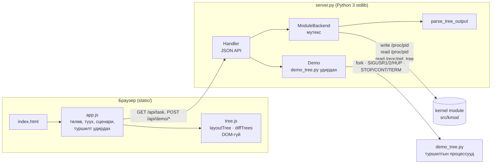
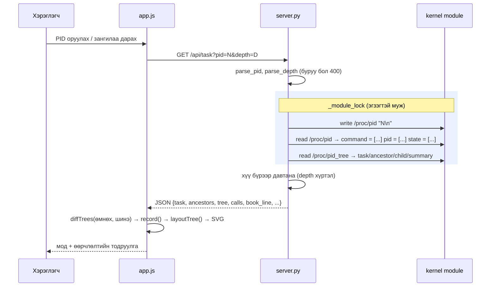

# Тайлангийн UI хэсэг — B190910014 (Interactive UI)

> `docs/TASKS.md`: *"Тайлангийн "Хэрэгжилт" хэсгийг kernel module болон UI хариуцсан гишүүд өөрсдөө бичиж өгнө."*
> Энэ файлыг тайлан хариуцсан **B232270108** (Report.pdf) болон хэрэглэгчийн manual хариуцсан **B241940099** ашиглана. Хэсгийн дугаарууд нь `OS_BD1_Guide.pdf`-ийн §7 тайлангийн бүтэцтэй тохирно. Бүх тоо **бодит хэмжилт** (Windows 11 + WSL2 Ubuntu 22.04.5, kernel 6.6.87.2-microsoft-standard-WSL2, Python 3.10.12, Node 22, Edge 154).

---

## 4. Системийн зохиомж — UI компонентууд



| Компонент | Үүрэг |
|---|---|
| `server.py` · `Handler` | HTTP + JSON API, оролт шалгах (`parse_pid`: зөвхөн цифр, 0–4194304; `parse_depth`: 0–6), static файл (path traversal хамгаалалттай) |
| `ModuleBackend.query()` | **Мутекс дотор**: `write("/proc/pid", "N\n")` → `read("/proc/pid")` (номын мөр) → `read("/proc/pid_tree")`; дуудлага бүрийн байт, µs-ийг бүртгэнэ |
| `parse_tree_output()` | `/proc/pid_tree`-ийн `task / ancestor / child / summary` мөрүүдийг JSON болгоно (`comm` мөрийн төгсгөлд — зай агуулж болно) |
| `build_tree()` | Сонгосон PID-ээс доош `depth` түвшин хүртэл хүү бүрийг module-ээс дахин асууж мод байгуулна (дээд хязгаар 400 зангилаа) |
| `Demo` | `demo_tree.py`-г тусдаа процессын бүлэгт ажиллуулна; signal-ийг **зөвхөн тэр бүлэгт** илгээнэ |
| `BookBackend` (`book` горим) | Module зөвхөн номын `/proc/pid`-тэй үед: command/pid/`__state` — module-ээс, эцэг/хүүгийн холбоо — `/proc/<pid>/stat`-аас; UI-д тэмдэглэнэ |
| `ProcfsBackend` (`--fallback`) | Module бэлэн болохоос өмнө UI хөгжүүлэхэд `/proc/<pid>/stat`-аас ижил бүтэц; UI-д "kernel module биш" гэж тод харуулна |
| `contract_check.py` | Module ↔ UI интерфейсийн шалгагч (34 шалгалт) — kmod-ийн хөгжүүлэгч module-аа UI-тай нийцэж буйг өөрөө шалгана |
| `app.js` | `select()` → `diffTrees()` (өмнөхтэй) → `record()` (түүх) → `render()`; SVG зурах, түүх ◀ ▶, сценари, туршилт удирдах, лог |
| `tree.js` | Цэвэр логик: `layoutTree()` (tidy tree + олон навчийг сүлжээ), `diffTrees()`; Node дээр тестлэгдэнэ |

### Нэг хүсэлтийн урсгал



---

## 5. Хэрэгжилт — UI

**Хэл, сан:** Python 3 стандарт сан (`http.server.ThreadingHTTPServer`, `json`, `threading`, `subprocess`, `signal`); HTML/CSS/JavaScript — **гадны сан, CDN байхгүй**. Сонголтын шалтгаан: шүүмжлэгч баг Manual дагуу ямар ч Linux дээр `python3 src/ui/server.py` гэхэд л ажиллана (BD1 удирдамж §3.6 "Өөр компьютерт дахин ажиллуулах").

### 5.1 Глобал PID ба мутекс
Номын интерфейс "бичих → унших" гэсэн **хоёр тусдаа систем дуудалт**, хадгалсан PID нь бүх процесст **дундын**. Сервер олон урсгалтай (хүсэлт бүр тусдаа урсгал) тул хоёр хүсэлт зэрэг ирвэл нэг нь нөгөөгийн PID-ийг уншина — **уралдааны нөхцөл**. Шийдэл:
```python
_module_lock = threading.Lock()
with _module_lock:                        # бичих + унших = нэг эгзэгтэй муж
    open("/proc/pid", "w").write(f"{pid}\n")
    book_line = open("/proc/pid").read()
    raw = open("/proc/pid_tree").read()
```
Нотолгоо: `test_10` — 2 урсгал × 15 зэрэг хүсэлт, **30/30 зөв PID**. Мутексгүй терминал тестэд 300 удаагаас 1–2 удаа нөгөөгийн PID уншсан (`tests/boundary`).

### 5.2 Мод байрлуулах — `layoutTree()` (tree.js)
1. Навч бүр дараалсан `x` авна; эцэг нь эхний ба сүүлийн хүүхдийнхээ **голд** (tidy tree).
2. Хүүхдүүд бүгд навч бөгөөд **≥ 7** бол 6 баганатай **сүлжээнд** багцлан, хүрээтэй ("N хүүхэд") зурна — systemd шиг олон хүүхэдтэй процесс бодит системд түгээмэл.
3. Өвөг эцгүүд (`real_parent` гинж, PID 1 хүртэл) сонгосон task-ийн дээр босоо баганад, эсвэл "товчлох" горимд нэг мөр (breadcrumb).
4. Самбарт багтахгүй бол `viewBox`-оор 60% хүртэл жижигрүүлж, шинэ task сонгоход түүнийг голлуулж гүйлгэнэ.

| Тохиолдол | Өргөн (px) |
|---|---|
| 20 эцэг × 19 навч (380 навч), нэг эгнээ (өмнө) | 66 154 |
| мөн тэр, сүлжээ (одоо) | **20 914** (3.2× бага) |

### 5.3 Өөрчлөлт илрүүлэх ба түүх
Шинэчлэлт бүрт өмнөх snapshot-той `diffTrees()`: `pid` нь шинээр гарсан → **ногоон** гэрэлтэлт + "шинэ"; `state_char` өөрчлөгдсөн → **шар** + "S→T"; алга болсон → улаан chip. Шинэ/алга болсныг зөвхөн эцгийнх нь хүүхдийн жагсаалт хоёр snapshot-д хоёуланд мэдэгдэж байсан үед тооцно — зангилаа нээх/хаах, гүн солиход *харагдах болсон* процесс "шинээр үүссэн" гэж андуурагдахгүй.

**Газар дээр нь нээх (⊕ / ⊖, <kbd>+</kbd> / <kbd>−</kbd>):** тасархай (хүүхдүүдийг нь асуугаагүй) зангилааг сонгосон task-ийг солилгүй нэг түвшнээр нээнэ. UI нээсэн PID-үүдийг `?expand=A,B`-ээр дамжуулж, сервер `build_tree()`-д тэдгээрийг `depth`-ээс гүн байсан ч module-ээс асууна — нэг хүсэлт, нэг мутекс, нэг snapshot. Хаасан эцгийн доорх эсвэл дууссан процессыг жагсаалтаас хасна; URL-д хадгалагдана. Snapshot бүр (сүүлийн 50) түүхэнд хадгалагдаж ◀ ▶-ээр алхамчилж эргэн харна (BD1 Peer Review §4: *"Алхамчилж харах эсвэл үр дүнг эргэн шалгах боломжтой юу?"*).

### 5.4 Туршилт удирдах ба аюулгүй байдал
| Товч | Signal | Кернелд болох зүйл |
|---|---|---|
| `+ Хүү процесс` | SIGUSR1 → demo_root | `fork()` — шинэ хүү (S) |
| `+ Zombie` | SIGUSR2 → demo_root | хүү шууд `exit()`, эцэг `wait()` хийгээгүй → **Z** |
| `wait() — цэвэрлэх` | SIGHUP → demo_root | `waitpid(-1, WNOHANG)` — zombie-ийн ПУБ чөлөөлөгдөнө |
| STOP / CONT / KILL | SIGSTOP / SIGCONT / SIGTERM → сонгосон | T / S / (дуусаад) Z |

Signal зөвхөн **demo процессын бүлэгт** (`os.getpgid(pid) == demo_root`) илгээгдэнэ — бусад PID → **HTTP 403**, demo_root → 400, зөвшөөрөгдөөгүй signal → 400. Хүү процесс бүр fork-ийн дараа signal handler-ийг `SIG_DFL` болгодог (эс бөгөөс SIGTERM нэг хүүд ирэхэд бүх бүлгийг устгах cleanup өвлөгдөнө). Demo root эцгээ (сервер) секунд тутам шалгаж, сервер `kill -9` хийгдсэн ч модыг цэвэрлэнэ.

### 5.5 Сценари
`▶ Сценари` — процессын амьдралын мөчлөгийг (OSC §3.3) 6 алхмаар, тайлбартай тоглуулж Түүхэнд хадгална: **fork → SIGSTOP (S→T) → SIGCONT (T→S) → SIGTERM (S→Z, эцэг wait() хийгээгүй) → wait() (Z алга)**.

### 5.6 Нотолгоо экспортлох, хүртээмж
- **`⤓ JSON`** — түүхийн snapshot бүрийн цаг, тайлбар (сценари), `book_line`, diff (шинэ/алга/өөрчлөгдсөн), module-тэй хийсэн write/read бүр, `/proc/pid_tree`-ийн **түүхий гаралт**, мод — тайланд "туршилтын үр дүнг дахин шалгаж болохуйц баримтжуулна" (BD1 §5) шаардлагад.
- **`⤓ SVG`** — одоогийн модыг өнгө, загвар дотор нь шингээсэн бие даасан зураг (тайлан, постер).
- **`⤓ PNG`** — мөн тэр SVG-г canvas дээр 2× зурна (Word, Teams-д шууд); маш өргөн модыг canvas-ын хязгаарт (~32 767 px) багтаана. Жишээ: demo мод → 2156×1424 px, 151 KB.
- **Гарын товч:** ↑ эцэг, ↓ хүүхэд, ← → ах дүү, Enter — хулганагүй ашиглах, + / − — газар дээр нь нээх / хаах; зангилаа бүр `role="button"`, `aria-label` ("demo_root, PID 1170, төлөв sleeping"), нээж болох зангилаа `aria-expanded`-тай.
- **Хайлт:** шүүлтүүр модон дээр таарсан зангилааг тодруулж бусдыг бүдгэрүүлнэ.

### 5.7 Алдаа боловсруулах
| Нөхцөл | UI-ийн хариу |
|---|---|
| `abc`, `-5`, `1.5`, хоосон, `99999999` | 400 · "Буруу оролт …" улаан banner, мод цэвэрлэгдэнэ |
| Байхгүй PID (module 0 байт) | 404 · "PID … олдсонгүй — module 0 байт буцаалаа (номын шаардлага)" |
| Module ачаалагдаагүй | 503 · ачаалах команд, `--fallback` санал; толгой хэсэгт улаан шошго |
| `/proc/pid` номын формат биш мөр буцаасан | 502 · буруу дүрслэхгүй, гаралтын эхний 80 тэмдэгт + `contract_check.py` санал |
| Сүлжээний түр алдаа (WSL `ERR_NETWORK_CHANGED`) | нэг удаа дахин оролдоно; бүтэлгүйтвэл мэдэгдэж, **өмнөх дүрслэлийг хадгална** |
| Demo ажиллаагүй үед удирдах | 409 |

---

## 6. Туршилт ба UI дүрслэл

| Юуг өөрчилж турших | Юуг ажиглах |
|---|---|
| PID (талбар, жагсаалт, зангилаа дээр дарах) | Номын мөр, task мэдээлэл, мод, өвөг эцгийн гинж PID 1 хүртэл |
| Гүн 0–4 | Модны түвшин; "module асуулга"-ын тоо (зангилаа тус бүрт 1) |
| Demo мод, `+ Хүү`, `+ Zombie`, STOP/CONT/KILL, `wait()` | Шинэ зангилаа ногоон, төлөв шар (S→T, S→Z), zombie алга болох |
| Автомат шинэчлэх 1/2/5 с | `demo_busy` R↔S ээлжлэх — бодит цагийн төлөв |
| `▶ Сценари` | 6 алхам, тайлбартай; Түүхэнд ◀ ▶ |
| Өвөг эцгийг товчлох | Гинж нэг мөрөнд; мод самбарт багтана |
| Module дуудлагын лог | write `/proc/pid` 5 байт → read 46 байт → read ~900 байт, µs |
| Шүүлтүүр (жнь `leaf`) | Модонд таарсан 2 зангилаа тодорч бусад нь бүдгэрнэ |
| `⤓ JSON` / `⤓ SVG` | Түүхийн бүх snapshot (түүхий гаралттай) / модны зураг татагдана |

**Тэмдэглэгээ:** зангилааны зүүн тууз + хүрээний өнгө = төлөв (R ногоон, S цэнхэр, D улбар шар, T саарал, Z улаан, I цайвар); бүдүүн цагаан хүрээ — сонгосон task; тасархай хүрээ — хүүхдүүдийг нь асуугаагүй; тасархай шугам — өвөг эцгийн гинж; тасархай хайрцаг — олон навч хүүхдийн сүлжээ.

---

## 8. Үр дүн — UI

### 8.1 Тест
| Багц | Тоо | Module ачаалсан | Fallback |
|---|---|---|---|
| `src/ui/tests/test_api.py` (Python unittest) | 24 | **24/24** (`book` горимд 23/23 + 1 алгассан) | **23/23** + 1 алгассан |
| `src/ui/tests/test_tree.mjs` (Node `node:test`) | 12 | **12/12** (DOM-гүй) | — |

`test_api.py`: статус · PID 1 номын формат · demo модны бүтэц (5 хүүхэд, Z/T, 5 урсгал) · depth 0/1 · буруу оролт → 400 · байхгүй → 404 · буруу depth · процессын жагсаалт · path traversal → 404 · зэрэг 30 хүсэлт (мутекс) · дуудлагын лог · demo тэмдэглэгээ · spawn/zombie · **STOP→T, CONT→S/R, TERM→Z, wait()→алга** · signal-ийн аюулгүй байдал (PID 1 → 403).
Шинэ (17–24): номын мөр ба `/proc/pid_tree`-ийн задлагч (зай, `=`, `|`, `]` агуулсан `comm`) · горим бүр (`fallback`, 503, формат буруу → 502) · `book` горим `module` горимтой ижил task/хүүхэд/өвөг эцэг өгнө · `expand` (газар дээр нь нээх; буруу оролт → 400). Node: нээх/хаах нь шинэ/алга болсон гэж тооцогдохгүй, нээлттэй эцгийн доорх бодит өөрчлөлт тооцогдоно.
`test_tree.mjs`: сүлжээний босго (6 навч — үгүй, 7 — тийм) · 13 навчийн сүлжээний координат · холимог мод · 380 навч · **санамсаргүй 300 мод — ямар ч хоёр зангилаа давхцахгүй, эцэг хүүхдээсээ дээр, бүгд хүрээнд** · diff · экспортын `stripLayout`.

### 8.2 Module ↔ UI интерфейсийн шалгалт (`contract_check.py`)
| Module | ✔ | ⚠ | ✖ | Илэрсэн |
|---|---|---|---|---|
| `src/kmod/pid.c` (kmod-proposal, засварын өмнө) | 33 | 0 | **1** | 8 байтаар уншихад мөр `command ` дээр тасарна — `if (*pos > 0) return 0;` → kmod-proposal-д зассан |
| `src/kmod/pid.c` (засварын дараа) | **34** | 0 | 0 | — |
| `tests/book_modules/book_ok.ko` (зөвхөн `/proc/pid`, зөв) | 15 | 1 | 0 | `/proc/pid_tree` алга → UI `book` горим |
| `tests/book_modules/book_naive.ko` (номын skeleton-ий хэв маяг) | 12 | 1 | **3** | global PID (WSL-д PID 1 = 1451), count-оос 37 байт илүү `copy_to_user`, `sscanf` нь `abc`-г хүлээн авч хуучин PID-ийг уншуулна |

Шалгагч UI-ийн өөрийн задлагчийг (`parse_book_line`, `parse_tree_output`) ашигладаг тул "✔" нь UI тухайн module-ийг зөв уншина гэсэн үг. `tests/book_modules/`-ийн хоёр туршилтын module-оор шалгагч алдааг үнэхээр илрүүлдгийг баталгаажуулсан.

### 8.3 Гүйцэтгэл
| Хэмжилт | Үр дүн |
|---|---|
| PID 1, depth 0 / 1 / 4 (WSL, ~25 процесс) | 0.8 / 10.6 / 3.0 мс серверт |
| Нэг module асуулга (3 систем дуудалт: write + 2 read) | ~0.2–1 мс (жнь 408 + 264 + 287 µs — `step6_history_calls.png`) |
| 400 зангилаатай модыг SVG-ээр зурах | 25 мс (нэг эгнээ) · 71 мс (сүлжээтэй) |
| Сценари (6 алхам) | ~9 с (алхам бүрийн хооронд 1.4 с завсар) |

### 8.4 Screenshot (бодит)
`src/ui/screenshots/`: `demo_tree.png` (depth 1), `step2_spawn.png` (fork — ногоон), `step5_zombie.png` (S→Z — шар), `step6_history_calls.png` (wait(); Түүх + Module дуудлагын лог), `expand_in_place.png` (газар дээр нь нээх, товчилсон өвөг эцэг). Headless Edge-ээр ажиллаж буй UI-аас авсан.

---

## 9. Хэлэлцүүлэг — UI

**Хязгаарлалт:**
- **Polling** — UI сервер рүү тогтмол хугацаанд асуудаг (1/2/5 с); кернел "push" хийдэггүй. Хоёр шинэчлэлтийн хооронд богино хугацаанд үүсээд алга болсон процесс харагдахгүй.
- **Зангилаа бүрт 1 module асуулга** — мод том бол асуулга олон (хязгаар 400). Нэг асуулгаар дэд модыг бүхэлд нь авах (`/proc/pid_tree`-д depth) нь kmod-той хамтарч хийх сайжруулалт.
- **Мутекс зөвхөн серверийн доторх** хүсэлтүүдийг хамгаална; өөр терминалаас `echo N > /proc/pid` хийвэл module-ийн глобал PID-д нөлөөлж болно (kmod-ийн дизайны хязгаарлалт).
- **Маш өргөн мод** (олон дэд модтой эцэг) 60%-аас доош жижигрэхгүй — хэвтээ гүйлгэх мөр гарна.
- **Fallback** горим нь kernel module-ийг туршихгүй — зөвхөн UI хөгжүүлэлтэд; UI-д тодорхой анхааруулдаг.
- **`book` горим** нь module ба procfs-ийг хоёр тусдаа агшинд уншдаг — хооронд нь процесс дуусвал 404 (дараагийн шинэчлэлтэд засагдана).

**Туршилтаар илэрсэн, зассан асуудлууд:**
| Асуудал | Засвар |
|---|---|
| depth=0 ба 1 ижил мод | `level < depth` → `level <= depth` (off-by-one) |
| Сервер `kill` хийгдэхэд demo процессууд өнчин үлддэг | demo_root эцгийг шалгаж өөрийгөө цэвэрлэнэ (`PR_SET_PDEATHSIG` нь урсгалтай серверт тохирохгүй) |
| fork-оор шинэ хүү root-ийн cleanup handler-ийг өвлөдөг | хүү бүрт `SIG_DFL` |
| `display: flex` нь `hidden` атрибутыг дарж banner харагддаг | `[hidden] { display: none !important }` |
| WSL-ийн түр сүлжээний алдаа бүх дүрслэлийг цэвэрлэдэг | 1 удаа дахин оролдох, өмнөх дүрслэлийг хадгалах |
| 380 навчтай мод 66 154 px өргөн | олон навч хүүхдийг сүлжээ болгох (20 914 px) |
| kmod-proposal-ийн `/proc/pid`-ийг 8 байтаар уншихад мөр тасардаг (`contract_check.py` илрүүлсэн) | `if (*pos > 0) return 0;`-ийг авч, `simple_read_from_buffer()`-т offset-ийг даатгах |
| Шалгагч `sleep`-ийн `__state`-ийг 1 гэж хүлээсэн, бодитоор 8193 | `__state` нь битийн маск (`TASK_INTERRUPTIBLE` \| `TASK_FREEZABLE`) — битээр шалгах |
| Нарийн дэлгэцэнд (366 px) статусын шошго хэвтээ гүйлгэх мөр үүсгэдэг | толгой хэсэг мөр шилждэг, шошго `…`-гээр тасарна, бүтэн текст `title`-д |

**BD2-т санал болгох сайжруулалт:** kmod-оос дэд модыг нэг асуулгаар авах; процессын шинэ/алга болохыг эвентээр (inotify/netlink) мэдэх; UI тестийг GitHub Actions-д (kernel-гүй хэсэг нь — задлагч, горим, Node тест).

---

## Хэрэглэгчийн manual-д зориулсан UI хэсэг (B241940099-д)

**Дүрслэлийн тэмдэг, өнгө:** дээрх §6 "Тэмдэглэгээ".

**Жишээ 1 — Номын интерфейсийг UI-аас:** `PID 1` товч → "Номын интерфейс" картанд `$ echo 1 > /proc/pid`, `$ cat /proc/pid`, `command = [systemd] pid = [1] state = [1]`.

**Жишээ 2 — Шинэ процесс мод дээр гарах (TASKS.md тест 5):** `Demo мод үүсгэх` → `+ Хүү процесс` → `demo_new_1` ногоон гэрэлтэлттэй "шинэ" гэж гарна; "Өөрчлөлт" мөрөнд `+ demo_new_1 (PID) шинээр үүссэн`.

**Жишээ 3 — Zombie:** `demo_new_1` дээр дарж сонгоод `KILL` → төлөв **S→Z** (шар); demo_root дээр буцаж `wait() — цэвэрлэх` → zombie алга болно.

**Жишээ 4 — Сценари:** `▶ Сценари` → 6 алхам автоматаар; дараа нь Түүхэнд ◀ ▶.

**Жишээ 5 — Газар дээр нь нээх:** гүн `0` → `Demo мод үүсгэх` → `demo_sleeper`-ийн **⊕** → сонголт `demo_root` хэвээр, доор нь `demo_leaf_1`, `demo_leaf_2` гарна; Түүхэнд "▸ demo_sleeper (PID) нээв"; **⊖** — хаана.

**Түгээмэл алдаа:**
| Мэдэгдэл | Шийдэл |
|---|---|
| ● module ачаалагдаагүй (улаан) | `sudo insmod src/kmod/pid.ko` эсвэл `--fallback` |
| ● module: зөвхөн /proc/pid (шар) | Module `/proc/pid_tree`-гүй — UI ажиллана, шатлалыг procfs-оос; бүрэн горимд kmod-д `/proc/pid_tree` нэмнэ |
| ✖ /proc/pid-ийн гаралт номын форматтай таарахгүй (502) | `python3 src/ui/contract_check.py` — ямар шалгалт ✖ болсныг харна |
| ✖ Буруу оролт 'abc' | зөвхөн цифр |
| ✖ PID … олдсонгүй | процесс дууссан/байхгүй |
| ✖ Сервертэй холбогдож чадсангүй | сервер ажиллаж байгаа эсэх (`python3 src/ui/server.py`), порт |
| STOP/KILL идэвхгүй | demo процесс биш эсвэл demo_root сонгогдсон — demo модны хүүхэд дээр дарна |
| `Address already in use` | `--port 9000` |
